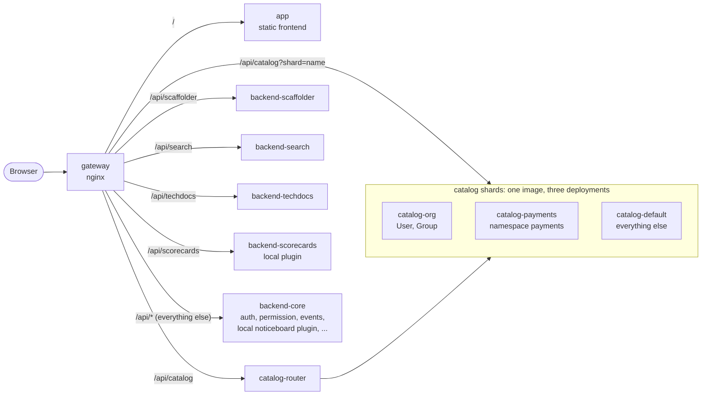

# Backstage, split into independently built and scaled services

A proof of concept for running [Backstage](https://backstage.io) (1.55) as
[multiple backends](https://backstage.io/docs/backend-system/building-backends/index#split-into-multiple-backends)
behind one nginx gateway, with the software catalog split into shards that are
picked from each request's own query parameters.

- **One image per service**, each with its own Dockerfile, built and pushed on
  its own: six backends, a catalog router, the frontend and the gateway.
- **Fast builds**: bundles are built on the host, and each backend's
  dependency layer is keyed on a lockfile pruned to _that backend's_
  production dependencies. A code change rebuilds an image in about 3 s; a
  dependency bump in one backend leaves every other image's cache intact.
- **Independent scaling**: every deployment scales on its own
  (`task scale SERVICE=... REPLICAS=...`), and traffic follows new replicas.
- **Query-based catalog sharding**: `/api/catalog` is served by three catalog
  deployments (people and teams; the `payments` namespace; everything else).
  A router sends each request only to the shards that can match it, and
  merges answers when several can. The UI, search, TechDocs and the scaffolder
  see one catalog.
- **Local plugins** (`plugins/`): two plugins written in this repository, each
  a frontend and a backend part, go through the same builds. Their frontends
  are compiled into the one app image; one backend runs inside `backend-core`,
  the other as a deployment of its own. Editing a plugin rebuilds only the
  images that contain it.
- **Independent releases**: every service has its own version. `task plan`
  works out which services changed since their last release (their code,
  their own resolved dependencies, the build toolchain, the files their image
  copies), and `task release:changed` builds, versions and pushes only those.
- **CI access without secrets**: CI jobs read the catalog with the OIDC token
  their CI platform issues them (GitHub Actions, or a local stand-in). The
  catalog checks it against the issuer's public keys and accepts it only from
  workflows in your own repositories. Read-only, and for the catalog only.

[docs/GUIDE.md](docs/GUIDE.md) walks through how it all works, with diagrams
of every flow: ingress, auth, catalog sharding, databases, and how changes
are detected and released. The full design, measurements, limitations and
the path to production are in [docs/PLAN.md](docs/PLAN.md).



Backends call each other through the gateway too: their discovery config
resolves every plugin to `http://gateway:8080/api/<pluginId>`, so the gateway
is the only place that knows which deployment hosts which plugin.

## Quick start

Requirements: Docker with Compose v2 (BuildKit on), Node 22 or 24, and
[Task](https://taskfile.dev/installation/). Yarn is pinned in `.yarn/releases`.

```sh
task build    # host bundles + one image per service, all in parallel
task up       # start everything; Backstage is at http://localhost:8080
task smoke    # check routing, sharding, auth, CI access, search, TechDocs and the plugins
```

Sign in as the guest user. On the catalog page, "All" lists components from two
shards as one sorted list; open `team-payments` to see its ownership, which
lives in another shard than the team itself. Noticeboard and Scorecards in the
sidebar are the local plugins.

Behind a TLS-intercepting proxy, pass its CA to image builds:
`task build EXTRA_CA_CERT=/path/to/ca.pem`.

## Everyday tasks

| Task                                            | What it does                                                                |
| ----------------------------------------------- | --------------------------------------------------------------------------- |
| `task build`                                    | Build every image, in parallel. Unchanged bundles are skipped.              |
| `task image:backend-search`                     | Build one image (any of the nine).                                          |
| `task deploy:backend-search`                    | Rebuild one image and roll only its containers.                             |
| `task push REGISTRY=ghcr.io/acme`               | Push every image (`push:<service>` for one).                                |
| `task release:backend-search REGISTRY=...`      | Build and push one service.                                                 |
| `task plan`                                     | Which services changed since their last release, and why.                   |
| `task release:changed REGISTRY=...`             | Build, push and version only the services that changed.                     |
| `task up:released`                              | Run every service at its released version.                                  |
| `task up DATABASES=dedicated`                   | Put the catalog shards and the scaffolder on database servers of their own. |
| `task ci:read -- kind=api`                      | Read the catalog as a CI job does, with an OIDC token instead of a secret.  |
| `task scale SERVICE=catalog-default REPLICAS=3` | Scale one deployment.                                                       |
| `task logs -- catalog-router gateway`           | Follow logs.                                                                |
| `task check`                                    | Type-check and unit tests.                                                  |
| `task e2e`                                      | Browser tests against the running stack.                                    |
| `task down` / `task reset`                      | Stop (and with `reset`, delete the database).                               |

Images are named `<REGISTRY>/backstage-poc/<service>:<TAG>`; `TAG` defaults
to `dev`. `task registry` starts a throwaway registry on `localhost:5000` if you
want to try pushing locally.

## Trying the catalog routing

Every catalog response says how it was routed:

```sh
TOKEN=$(curl -s -X POST localhost:8080/api/auth/guest/refresh | jq -r .backstageIdentity.token)
api() { curl -s -D - -o /dev/null -H "authorization: Bearer $TOKEN" "localhost:8080/api/catalog/$1" | grep -i x-catalog; }

api 'entities/by-query?filter=kind=group'                # single: org
api 'entities/by-name/component/payments/ledger'         # single: payments
api 'entities/by-query?filter=kind=component'            # fanout: payments,default
api 'entity-facets?facet=kind'                           # fanout: org,payments,default
```

`?shard=<name>` (or an `X-Catalog-Shard` header) makes the gateway send a
request straight to one shard, bypassing the router.

## Local plugins

Two plugins live in `plugins/`, written like any Backstage plugin
(`yarn new`), to show that locally sourced code goes through the same fast,
independent builds as plugins from npm:

| Plugin      | Frontend                                                             | Backend                                                                                                                     | Backend runs in                               |
| ----------- | -------------------------------------------------------------------- | --------------------------------------------------------------------------------------------------------------------------- | --------------------------------------------- |
| noticeboard | A page to post and read notices                                      | Notices in the plugin's own database, with Knex migrations shipped in the package                                           | `backend-core`, next to the platform plugins  |
| scorecards  | A card on every component page, and a page scoring the whole catalog | Scores entities it reads from the (sharded) catalog; check definitions shared with the frontend through `scorecards-common` | `backend-scorecards`, a deployment of its own |

- **Frontend plugins** are dependencies of `packages/app`. The app build
  compiles them from source, and feature discovery (`app.packages: all`)
  installs them, sidebar entries included, without touching the app's code.
- **Backend plugins** are dependencies of the backend that hosts them, added
  with `backend.add(import(...))`. The backend's bundle carries their built
  code (and assets such as migrations), and its pruned lockfile carries their
  npm dependencies, so a dependency change only invalidates that image's
  cache.
- **Builds stay independent**: each bundle task is fingerprinted on its
  package plus the local packages it pulls in (`scripts/workspace-deps.mjs`).
  Editing the noticeboard backend rebuilds `backend-core` only; editing
  `scorecards-common` rebuilds the app and `backend-scorecards`; every other
  image keeps its exact digest.

To add a plugin to an existing backend, depend on it and `backend.add` it;
plugins in `backend-core` need no routing change. To give one its own
deployment, copy `packages/backend-scorecards` and add a compose service and a
gateway `location`. Details and measurements:
[docs/PLAN.md, section 7](docs/PLAN.md#7-local-plugins).

## Databases

Each plugin and each catalog shard already has a database of its own, so any
service can move to a database server of its own with no code change:
`task up DATABASES=dedicated` puts the `payments` shard, the other two shards
and the scaffolder on three more Postgres servers
([docs/PLAN.md, section 3.5](docs/PLAN.md#35-databases-and-giving-services-servers-of-their-own)).

## CI access

CI jobs read the catalog with the OIDC token their CI platform issues them,
so no Backstage secret is stored in CI. The catalog shards check those tokens
([deploy/external-access.yaml](deploy/external-access.yaml)) with
`jwks-claims`, an external access type added in
[packages/backend-catalog/src/ciAccess.ts](packages/backend-catalog/src/ciAccess.ts):
Backstage's own `jwks` check (signature against the issuer's public keys,
issuer, audience, expiry) plus required claims. The tokens only read the
catalog; every other backend refuses them.

Locally, `ci-oidc`, a stand-in for GitHub's token service, plays the CI
platform:

```sh
task ci:read                                          # components and owners
task ci:read -- kind=api,metadata.namespace=payments  # any catalog filter
```

[scripts/ci-catalog-read.mjs](scripts/ci-catalog-read.mjs) is what a CI job
runs: it asks the CI platform for a token for the audience `backstage-ci`, then
pages through `/api/catalog/entities/by-query`. In GitHub Actions it gets that
token from GitHub, as in
[.github/workflows/catalog-read.yml](../.github/workflows/catalog-read.yml), once
the deployment trusts GitHub's issuer:

```sh
CI_OIDC_ISSUER=https://token.actions.githubusercontent.com
CI_OIDC_JWKS_URL=https://token.actions.githubusercontent.com/.well-known/jwks
CI_OIDC_AUDIENCE=backstage-ci
```

**Why the claims check**: GitHub's issuer signs tokens for every repository
on GitHub, and a workflow picks its own audience, so a valid signature only
proves that _some_ workflow asked. The config therefore also requires
`repository_owner_id: '857801'`, i.e. workflows in repositories owned by
`rgardam`: by account ID rather than name, because a name can be given up and
registered by someone else. Set your own with `gh api users/<name> --jq .id`
(`orgs/<name>` for an organisation), or allow single repositories with
`repository_id` (`gh api repos/<owner>/<repo> --jq .id`). Every claim listed
must match, and `jwks-claims` refuses to start without one.

| Request with a CI token                                  | Answer |
| -------------------------------------------------------- | ------ |
| Catalog reads, on any shard                              | 200    |
| Catalog writes (refresh, registering a location)         | 403    |
| Any other backend (search, scorecards, ...)              | 401    |
| A valid token from another owner's workflow              | 401    |
| Owner name `rgardam`, but another account's ID           | 401    |
| A token for another audience, or with a forged signature | 401    |

Backstage names the caller `external:ci:<the token's sub claim>` in its audit
log, e.g. `external:ci:repo:rgardam/rgardam:ref:refs/heads/main`, and each
shard logs every token it refuses with the claim that failed.

## Releasing only what changed

Each service is versioned and released on its own. `deploy/releases.json`
records every service's version and a fingerprint of the inputs it was built
from, and `task plan` compares against it. After editing the noticeboard
plugin and updating a dependency that only the search backend uses:

```text
$ task plan
Release plan: 2 of 9 services need a new release

  SERVICE             RELEASED  NEXT   CHANGES
  app                 1.0.0     -      unchanged
  backend-catalog     1.0.0     -      unchanged
  backend-core        1.0.0     1.0.1  code: plugins/noticeboard-backend/src/router.ts
  backend-scaffolder  1.0.0     -      unchanged
  backend-scorecards  1.0.0     -      unchanged
  backend-search      1.0.0     1.0.1  dependencies: @backstage/plugin-search-backend-module-pg 0.5.59 → 0.5.58
  backend-techdocs    1.0.0     -      unchanged
  catalog-router      1.0.0     -      unchanged
  gateway             1.0.0     -      unchanged
```

- **What counts as a change**: the service's code and the local plugins and
  libraries it bundles (not tests, docs or the plugin dev harness), its
  production dependencies as resolved in the lockfile, the Backstage CLI that
  builds it, and the files its Dockerfile copies (config, examples) plus the
  Node.js version. A dependency bump in one backend flags only that backend.
- **Releasing**: `task release:changed REGISTRY=ghcr.io/acme` builds and
  pushes only the flagged services as `<service>:<next version>` (`BUMP=minor`
  or `major` for bigger steps) and records the new versions. Commit
  `deploy/releases.json`, then `task release:tag` tags `<service>@<version>`.
- **Deploying**: `task up:released` runs each service at its recorded
  version; after a release, only the released services' containers change.
- **CI**: `.github/workflows/release.yml` shows the plan on every pull request
  that touches this folder and, run by hand, releases the changed services to
  GHCR.

The plan needs no install and no network, and takes about half a second once
its cache is warm. Details are in
[docs/PLAN.md, section 8](docs/PLAN.md#8-releasing-services-independently).

## Repository layout

| Path                                 | Contents                                                                                                                          |
| ------------------------------------ | --------------------------------------------------------------------------------------------------------------------------------- |
| `packages/app`                       | Frontend, plus its nginx image and runtime-config entrypoint                                                                      |
| `packages/backend-core`              | auth, permission, events, proxy, notifications, signals, user settings, kubernetes, MCP actions, and the local noticeboard plugin |
| `packages/backend-catalog`           | The catalog, plus the shard guard and the CI token check (`jwks-claims`). One image, one deployment per shard                     |
| `packages/backend-scaffolder`        | Software templates                                                                                                                |
| `packages/backend-search`            | Search API, Postgres engine, catalog and TechDocs collators                                                                       |
| `packages/backend-techdocs`          | TechDocs, in the one image that carries Python and MkDocs                                                                         |
| `packages/backend-scorecards`        | A deployment for one local plugin, scorecards                                                                                     |
| `packages/catalog-router`            | Shard-aware router for `/api/catalog` (no runtime dependencies)                                                                   |
| `packages/catalog-sharding`          | Shard rules shared by the router and the guard, inlined into both at build time                                                   |
| `plugins/`                           | Local plugins: noticeboard and scorecards, frontend and backend parts                                                             |
| `gateway/`                           | The nginx gateway image                                                                                                           |
| `deploy/`                            | Shard topology (`catalog-shards.json`), per-shard catalog config, CI access, and the release record (`releases.json`)             |
| `docker/`                            | Entrypoint shared by the backend images, and the stand-in CI token service (`ci-oidc/`)                                           |
| `scripts/`                           | Release planning, lockfile pruning, bundle inputs for Task, the smoke test, and the CI catalog reader                             |
| `app-config*.yaml`                   | Config shared by all backends; per-deployment config is mounted into `/app/config.d`                                              |
| `Taskfile.yml`, `docker-compose.yml` | Orchestration                                                                                                                     |
| `.github/workflows/release.yml`      | CI: the release plan on pull requests, releases of the changed services on demand                                                 |
| `.github/workflows/catalog-read.yml` | CI reading the catalog with GitHub's OIDC token, on demand                                                                        |
