# How the split Backstage setup works

Backstage runs here as nine images, each built, versioned and released on its
own: an nginx gateway, the frontend, and seven backend services behind it. The
catalog runs as three shards, split by namespace and kind, behind a router
that asks only the shards that can hold an answer. The UI, search and every
plugin still see one catalog.

This guide follows a request through the system: how it gets in, how it is
authenticated, how the catalog finds its answer across shards, where the data
lives, and how each service is built and released only when it changed. To
run it, see the [README](../README.md); for design decisions, measurements
and limits, [PLAN.md](PLAN.md).

- [The pieces](#the-pieces)
- [Ingress: how a request finds its backend](#ingress-how-a-request-finds-its-backend)
- [Auth](#auth)
- [Catalog sharding](#catalog-sharding)
- [Databases](#databases)
- [Builds, releases and change detection](#builds-releases-and-change-detection)
- [In the repository](#in-the-repository)

## The pieces

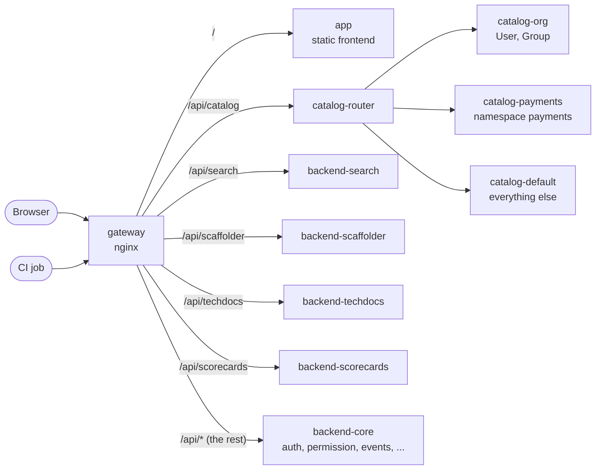

| Service              | Image                | What it runs                                                                                   |
| -------------------- | -------------------- | ---------------------------------------------------------------------------------------------- |
| `gateway`            | `gateway`            | nginx: the only entry point, and the map of which deployment serves which plugin               |
| `app`                | `app`                | The frontend, as static files                                                                  |
| `backend-core`       | `backend-core`       | auth, permission, events, proxy, notifications, signals, and the local noticeboard plugin, ... |
| `catalog-router`     | `catalog-router`     | `/api/catalog`: picks the shards for each request, merges their answers                        |
| `catalog-org`        | `backend-catalog`    | The catalog shard for every User and Group                                                     |
| `catalog-payments`   | `backend-catalog`    | The catalog shard for the `payments` namespace                                                 |
| `catalog-default`    | `backend-catalog`    | The catalog shard for everything else                                                          |
| `backend-search`     | `backend-search`     | Search, and the collators that index the catalog and TechDocs                                  |
| `backend-scaffolder` | `backend-scaffolder` | Software templates                                                                             |
| `backend-techdocs`   | `backend-techdocs`   | TechDocs                                                                                       |
| `backend-scorecards` | `backend-scorecards` | The local scorecards plugin, deployed on its own                                               |

Every deployment scales on its own (`task scale SERVICE=... REPLICAS=...`).
Locally, `ci-oidc` also runs: a stand-in for a CI platform's token service,
used by [CI access](#ci-access).

## Ingress: how a request finds its backend

Every request enters through the gateway, which routes on the path, and
catalog requests also on `?shard=` or an `X-Catalog-Shard` header. It checks
no credentials: each backend checks every token itself.

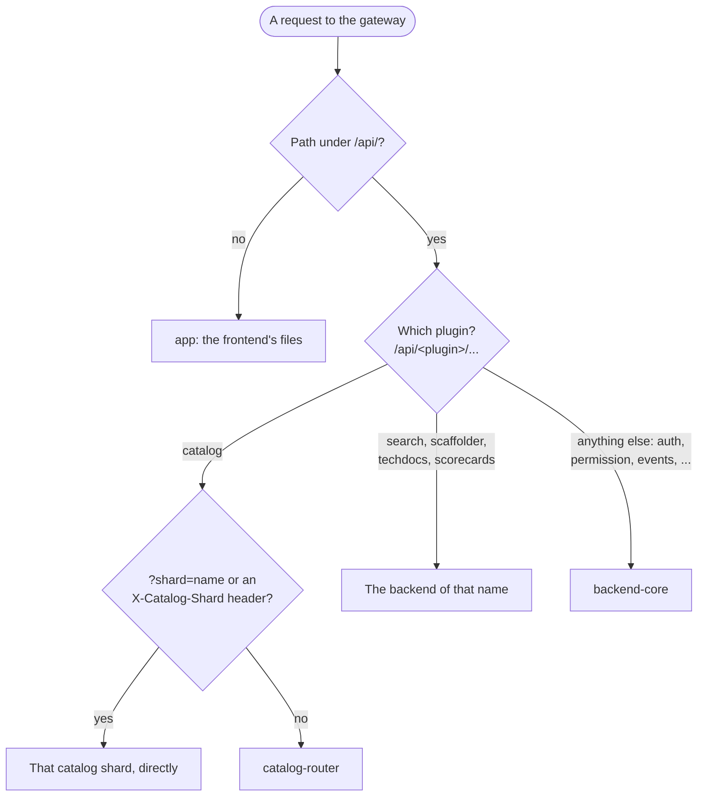

Backends call each other through the same gateway. Their discovery config
resolves every plugin, their own included, to
`http://gateway:8080/api/<pluginId>`, so the gateway's routes are the only
place that knows which deployment hosts which plugin: moving a plugin to
another deployment changes its `backend.add` and one gateway route, and no
other backend. Here, search reads the catalog to index it:

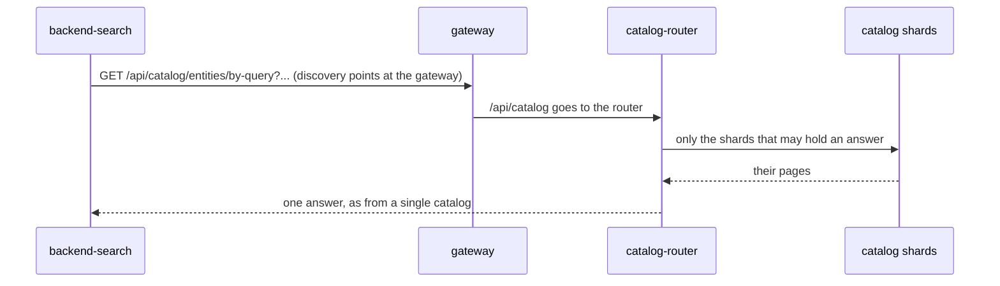

The gateway resolves service names again every 5 seconds, so new replicas get
traffic without a restart. Right after a container is replaced it can still
hold the old address for those seconds, so `task up` and `task deploy:*` wait
until every gateway route answers
([scripts/wait-for-gateway.mjs](../scripts/wait-for-gateway.mjs)).

## Auth

Nothing is shared between deployments: no secret, no session store. Every
token is a signed JWT, and a backend checks it against the issuer's public
keys: Backstage's own through the gateway, a CI platform's from the platform.
It caches them for 10 minutes, and fetches them again early for a key it has
not seen.

| Token                      | Issued by                        | Checked against                              |
| -------------------------- | -------------------------------- | -------------------------------------------- |
| User token                 | the auth plugin, in backend-core | `/api/auth/.well-known/jwks.json`            |
| Plugin token               | the calling plugin               | `/api/<caller>/.backstage/auth/v1/jwks.json` |
| CI token (external access) | the CI platform (GitHub Actions) | the CI platform's JWKS, plus required claims |

### Signing in

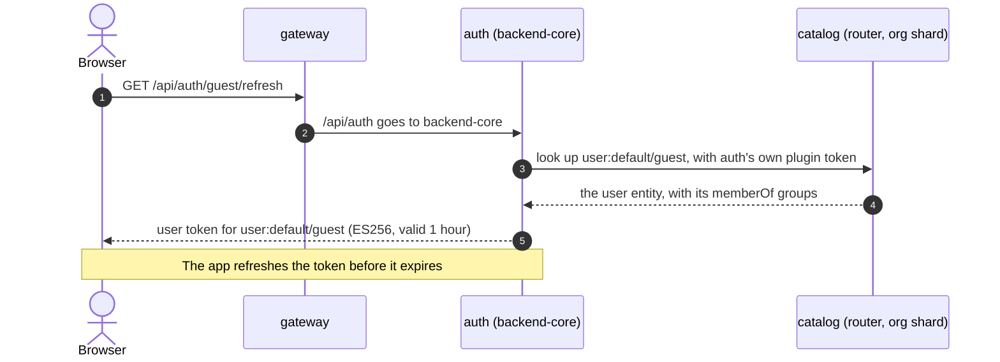

The guest provider stands in for a real sign-in provider (OIDC, GitHub, ...),
which would add a redirect to the identity provider before step 3. The token
does not list the user's groups (Backstage 1.55 leaves them out); a backend
that needs them asks auth's `/v1/userinfo` and caches the answer.

### A user request, and one backend calling another

Every request from the browser carries the user token. A backend that calls
another plugin on the user's behalf signs a short-lived plugin token with its
own key: it names the caller and the target, and carries a limited copy of
the user's token, so the target knows who the call is for.

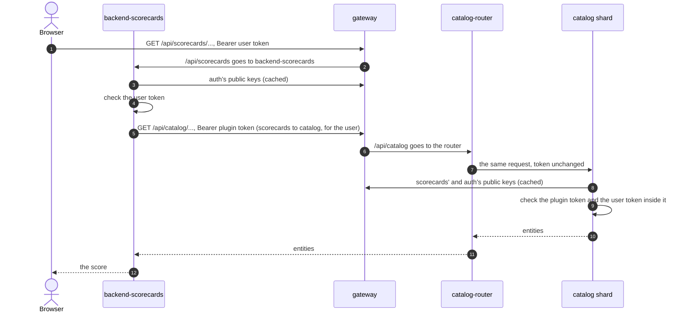

The router never checks tokens: it passes the `Authorization` header to every
shard it asks, and each shard checks it. A request without a valid token gets
401 from whichever backend receives it.

### The catalog's keys: three shards, one key set

Each replica of a plugin signs with a key pair it keeps in memory and replaces
hourly, and stores the public keys in the plugin's database for three hours.
Replicas of one deployment share that database, so each publishes all of
their public keys. The three catalog shards all sign as plugin `catalog`, but
each has its own database, while a verifier fetches "the catalog's" keys
from one address, `/api/catalog/.backstage/auth/v1/jwks.json`, which lands on
the router. So the router answers it with all three shards' public keys.

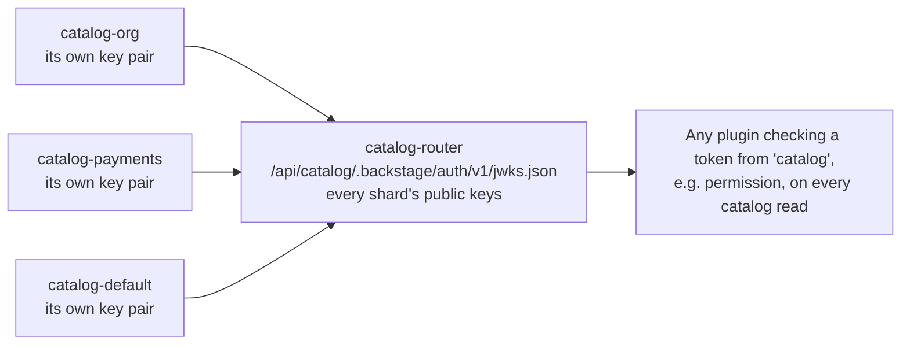

Without the union, a token signed by the payments shard would fail whenever
the verifier's key request reached another shard.

### Permissions

The permission framework is on. On every catalog read for a user, the shard
asks the permission plugin in backend-core whether the user may read; the
policy here allows everything. A plugin calling on a user's behalf is checked
as that user. Plugins calling as themselves, and CI, are not put to the
policy: Backstage decides from their access restrictions alone.

### CI access

CI jobs read the catalog with the short-lived OIDC token their CI platform
issues them, so no Backstage secret is stored in CI. Only the catalog shards
accept these tokens, with `jwks-claims`
([ciAccess.ts](../packages/backend-catalog/src/ciAccess.ts)): Backstage's
`jwks` check plus required claims. GitHub's issuer signs tokens for every
repository on GitHub, and a workflow picks its own audience, so only a claim
such as `repository_owner_id` says whose workflow is calling.

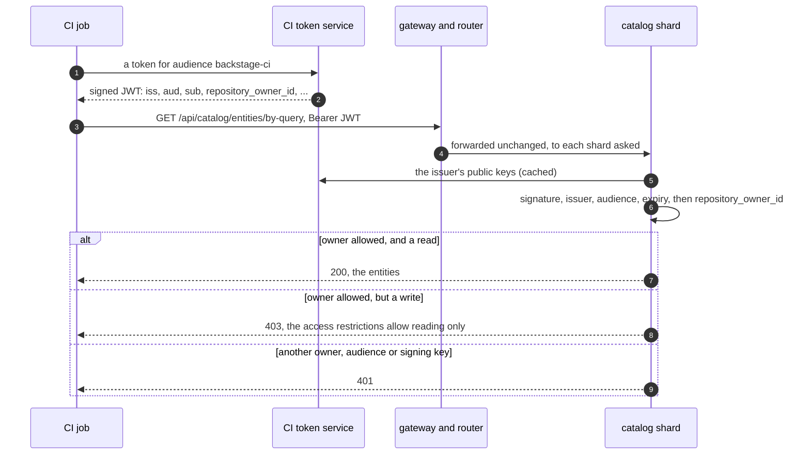

In GitHub Actions the token service is GitHub's (`id-token: write` in the
workflow); locally it is the `ci-oidc` stand-in, with the same interface and
claims. `task ci:read` runs the same script a CI job runs
([scripts/ci-catalog-read.mjs](../scripts/ci-catalog-read.mjs)). Setup, and
which owner IDs to allow: README, "CI access".

## Catalog sharding

### Who owns what

Every entity belongs to exactly one shard: the first one, in order, whose rule
matches its kind and namespace
([deploy/catalog-shards.json](../deploy/catalog-shards.json)).

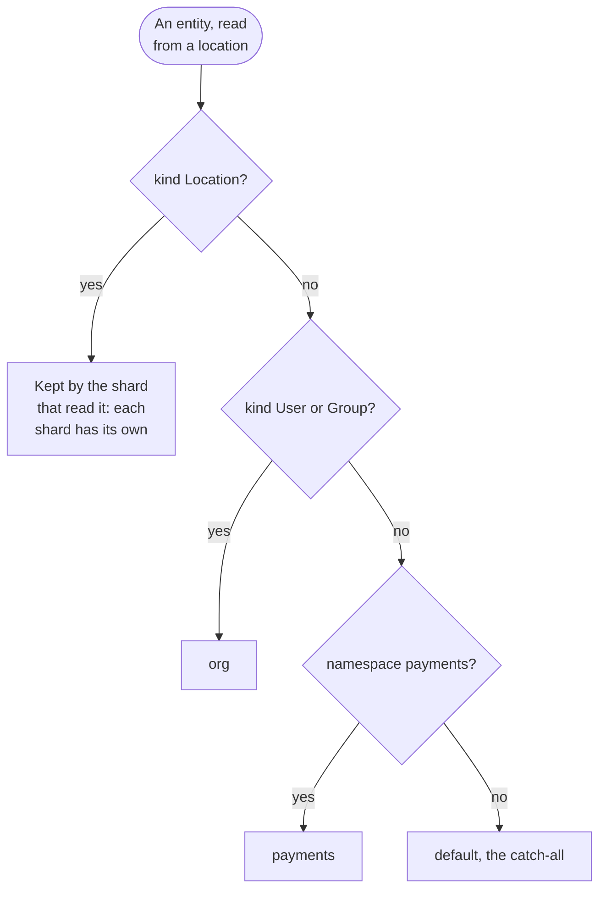

Each shard reads its own locations, and runs a guard that rejects an entity it
does not own, naming the shard that does
([shardGuard.ts](../packages/backend-catalog/src/shardGuard.ts)). So the
router can trust the rules: no entity sits in a shard the router would not
ask.

### A query, step by step

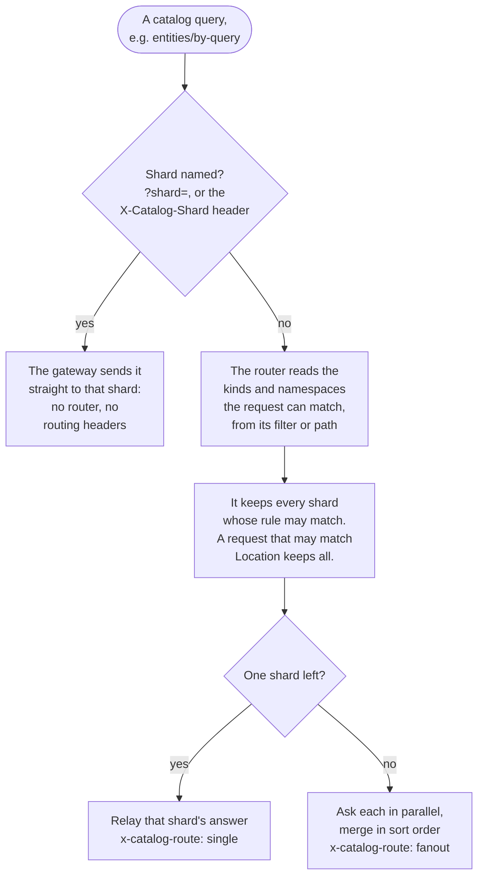

| Request to `/api/catalog/...`                          | Shards asked      | Why                                                               |
| ------------------------------------------------------ | ----------------- | ----------------------------------------------------------------- |
| `entities/by-query?filter=kind=group`                  | org               | Groups only live in org                                           |
| `entities/by-query?filter=kind=component`              | payments, default | Components can be in either                                       |
| `...filter=kind=component,metadata.namespace=payments` | payments          | The namespace decides                                             |
| `...filter=kind=user,metadata.namespace=payments`      | org               | Users stay in org, whatever their namespace                       |
| `entities/by-name/component/payments/ledger`           | payments          | The path names the kind and the namespace                         |
| `...filter=metadata.namespace=payments`                | all three         | No kind, so it may match Location entities, which every shard has |
| `entity-facets?facet=kind`                             | all three         | Nothing narrows it down                                           |
| any request with `?shard=payments`                     | payments          | Named explicitly: the gateway sends it straight there             |

Responses from the router carry `x-catalog-route` (`single` or `fanout` for
queries) and `x-catalog-shards` (for queries, the shards asked); the gateway
logs both.
Pruning is conservative: it may ask a shard that turns out to have nothing,
but never skips one that has an answer.

### Paging across shards

When several shards answer, each page is a merge of their sorted pages, and
the cursor records how far each shard has got. The cursor is all the state
there is, so any router replica can serve the next page.

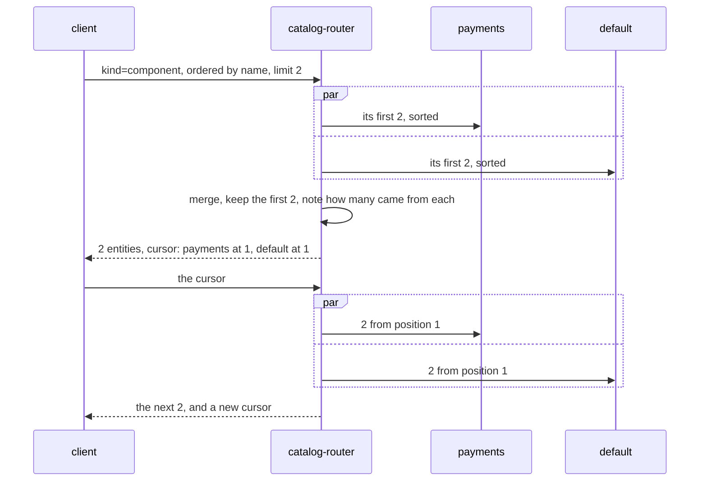

`totalItems` is the sum of the shards' totals, counted for the first page and
carried in the cursor. Pages neither skip nor repeat entities unless entities
are added or removed between them.

### Writes

- **Refresh and validation** go to the shard that owns the entity, from the
  kind and namespace in the request.
- **A delete** names only a uid, so every shard is asked, and the one that has
  it deletes it.
- **A new location** cannot be routed by its URL, since what decides the owner
  are the entities inside:

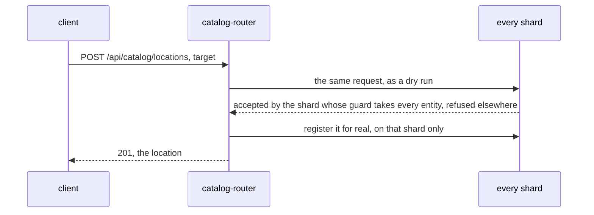

A location that mixes entities owned by different shards is refused, with the
catch-all's error, which names the first entity it does not own and that
entity's shard.

### Ownership across shards

An entity can be owned by a user or team in another shard, and is here: every
entity in the payments shard is owned by `group:default/team-payments`, which
lives in org. The relation is stored with the entity that declares it.

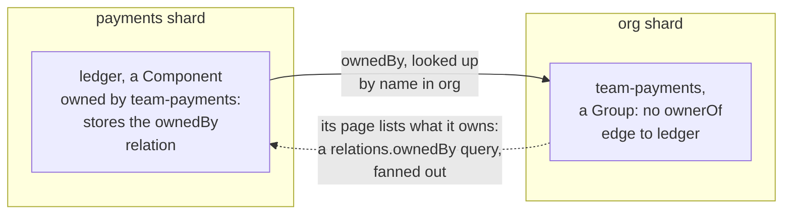

What reads ownership from the owned entity works across shards: the owner on
the entity page, the "Owned" filter, the team's Ownership card, and owner-based
permission rules. Reverse relations do not cross: the team entity has no
`ownerOf` edge to `ledger`, so the relations graph centred on the team, or a
`relations.ownerOf=...` filter, misses it. The same goes for every relation
pair across shards (`partOf` and `hasPart`, `dependsOn` and `dependencyOf`,
...), and ancestry stays within a shard. Keeping all users and groups in one
shard, as org does, keeps group membership whole.

### Two instances, different namespaces

A shard's rule can name namespaces, so two catalog instances can each own a
set of namespaces, one of them taking everything else:

```json
{
  "catalogSharding": {
    "shards": [
      {
        "name": "team-a",
        "target": "http://catalog-team-a:7007/api/catalog",
        "match": { "namespaces": ["team-a", "team-a-legacy"] }
      },
      { "name": "default", "target": "http://catalog-default:7007/api/catalog" }
    ],
    "localKinds": ["Location"]
  }
}
```

Adding one takes configuration, not a new catalog image: the shard in
`deploy/catalog-shards.json` (first matching rule wins), a config file with its
name, database prefix, `catalog.rules` and locations, a deployment of the
catalog image like the other shards (mounting the topology, its config and
`deploy/external-access.yaml`, or CI requests that reach it fail), and a
restart of the router and the shards, which read the topology at startup. Routing `?shard=team-a` too means a gateway
change, so a new gateway image. Details: [PLAN.md, section 9](PLAN.md#9-configuration-reference).

## Databases

Every plugin has a database of its own, and every catalog shard a database
prefix of its own, so any of them can move to a dedicated server by changing
its database address (`POSTGRES_HOST`) and copying its data across.
`task up DATABASES=dedicated` points the catalog shards and the scaffolder at
new, empty servers ([docker-compose.databases.yml](../docker-compose.databases.yml)):
the shards read their locations again, and the scaffolder starts without task
history.

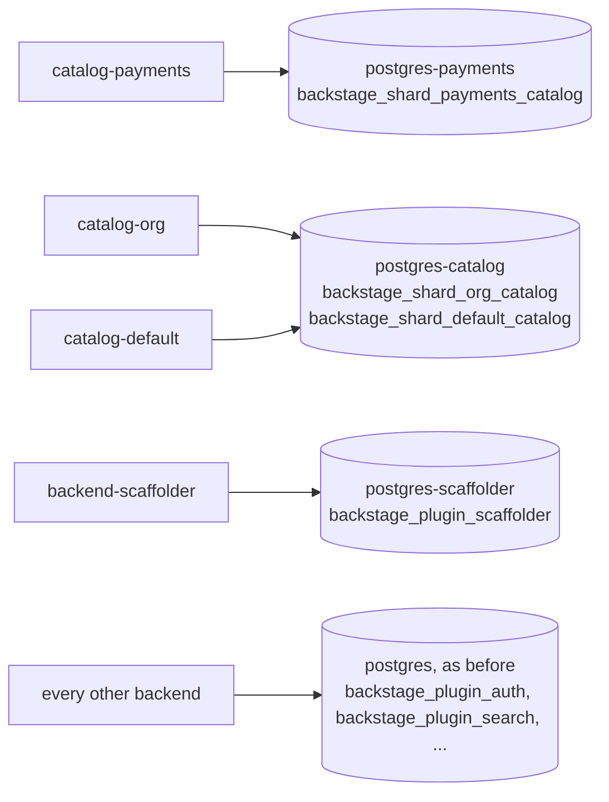

| Split                                          | Effort         | How                                                                                          |
| ---------------------------------------------- | -------------- | -------------------------------------------------------------------------------------------- |
| A deployment on its own server                 | Low            | Its database host; move the data with `pg_dump` and `pg_restore`                             |
| One plugin of a deployment on its own server   | Low            | `backend.database.plugin.<pluginId>.connection`                                              |
| A catalog shard (a set of namespaces or kinds) | Low            | Its database host; it can rebuild from its locations, except ones registered through the API |
| One catalog's data across several servers      | Not supported  | Its tables join and transact in one database; shard it instead, as here                      |
| Read replicas for one shard                    | Medium to high | A read-only catalog deployment on a replica, the router sending it reads; not built here     |

## Builds, releases and change detection

### How an image is built

Bundles are built on the host, where dependencies and build caches are warm.
Each backend's image installs a lockfile pruned to that backend's production
dependencies, in its own cached layer, then adds its bundle on top.

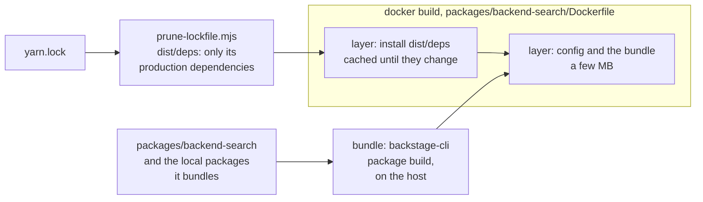

A code change rebuilds the bundle and the top layer only, in seconds. A
dependency bump in one backend changes only that backend's pruned lockfile, so
every other image keeps its dependency layer; their top layers are rebuilt
anyway, since every bundle carries the whole `yarn.lock`. Task skips a bundle
whose sources did not change, and `task deploy:<service>` rebuilds one image
and replaces only its containers.

### Detecting which services changed

`task plan` decides which services need a new release. Each service, meaning
each `Dockerfile`, gets a fingerprint of exactly the inputs its image is
built from, compared with the fingerprint recorded at its last release in
[deploy/releases.json](../deploy/releases.json)
([scripts/release.mjs](../scripts/release.mjs)).

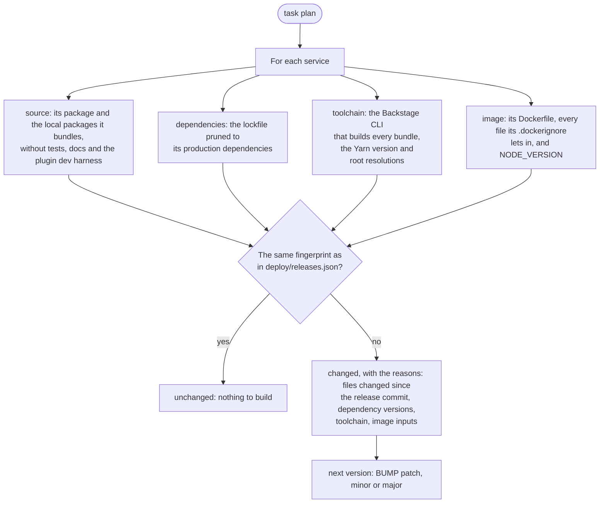

The inputs follow what really reaches an image:

- **Plugins and libraries count where they are bundled.** A frontend plugin
  is compiled into the app; a backend plugin goes into the bundle of the
  backend that hosts it; an inline package such as
  `packages/catalog-sharding` counts for the packages that import it.
- **Dependencies count as resolved for each service.** A bump flags exactly
  the services whose pruned lockfile changes: a package only one backend uses
  flags that backend, one several share flags them all. The plan names the
  versions that changed.
- **Config counts where it is copied.** `app-config.yaml` is compiled into the
  frontend and copied into every backend image, `app-config.production.yaml`
  into every backend image, and `examples/` only into the catalog, scaffolder
  and TechDocs images.
- **Left out on purpose**: tests, stories, package Markdown, lint config and
  the plugin dev harness, which change nothing an image runs, and the full
  `yarn.lock` inside each bundle, which the dependencies input stands for.
  Nothing outside the inputs above counts.

Each kind of change, and exactly what it flags (checked by
[scripts/release.test.mjs](../scripts/release.test.mjs), part of
`task check`):

| Change                                                               | Services flagged                                      |
| -------------------------------------------------------------------- | ----------------------------------------------------- |
| Code in a backend plugin (`plugins/noticeboard-backend`)             | backend-core                                          |
| Tests, docs or the dev harness of a plugin                           | none                                                  |
| Code in a frontend plugin (`plugins/scorecards`)                     | app                                                   |
| A library shared by the frontend and a backend (`scorecards-common`) | app, backend-scorecards                               |
| An inline package (`packages/catalog-sharding`)                      | backend-catalog, catalog-router                       |
| `app-config.yaml`                                                    | app and the six backends                              |
| `app-config.production.yaml`                                         | the six backends                                      |
| `gateway/default.conf.template`                                      | gateway                                               |
| One service's `Dockerfile`                                           | that service                                          |
| `examples/`                                                          | backend-catalog, backend-scaffolder, backend-techdocs |
| A dependency only one backend uses                                   | that backend                                          |
| The build toolchain (`@backstage/cli`)                               | app, the six backends, catalog-router                 |
| `NODE_VERSION`                                                       | the six backends and catalog-router                   |

For example, after the CI access check was added to the catalog backend:

```text
Release plan: 1 of 9 services needs a new release

  SERVICE             RELEASED  NEXT   CHANGES
  app                 1.0.1     -      unchanged
  backend-catalog     1.0.1     1.0.2  code: packages/backend-catalog/package.json, packages/backend-catalog/src/ciAccess.ts, packages/backend-catalog/src/index.ts; dependencies: lockfile entries changed, same versions
  backend-core        1.0.1     -      unchanged
  ...
```

### Releasing

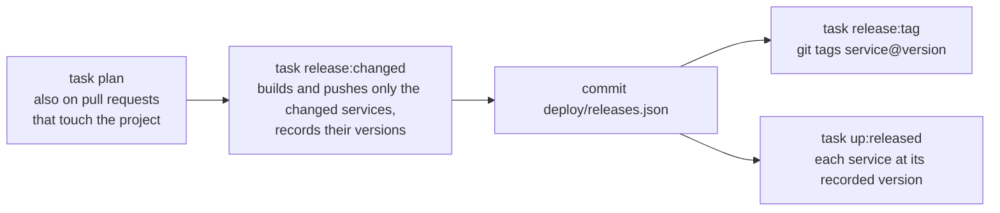

Images carry their version, commit and fingerprint as labels
(`org.opencontainers.image.version`, `org.opencontainers.image.revision`,
`io.backstage-poc.inputs`). In CI
([release.yml](../../.github/workflows/release.yml)), every pull request that
touches `backstage-split-backends/` shows the plan in its job summary; running
the workflow by hand builds and pushes the changed services to GitHub's
container registry, commits the record and pushes the tags. Rolling out with
`task up:released` replaces only the containers of the services whose version
changed; the others keep running.

The project moved into its folder after its services were last released. Until
a service is released again, the plan can say that its code changed, but not
which files.

## In the repository

| Part                                    | Where                                                                                              |
| --------------------------------------- | -------------------------------------------------------------------------------------------------- |
| Gateway routes                          | [gateway/default.conf.template](../gateway/default.conf.template)                                  |
| Shard topology and per-shard config     | [deploy/catalog-shards.json](../deploy/catalog-shards.json), [deploy/catalog/](../deploy/catalog)  |
| Shard rules, shared by router and guard | [packages/catalog-sharding](../packages/catalog-sharding/src)                                      |
| Catalog router                          | [packages/catalog-router](../packages/catalog-router/src)                                          |
| Shard guard and CI token check          | [packages/backend-catalog/src](../packages/backend-catalog/src)                                    |
| CI access config and stand-in           | [deploy/external-access.yaml](../deploy/external-access.yaml), [docker/ci-oidc](../docker/ci-oidc) |
| Dedicated database servers              | [docker-compose.databases.yml](../docker-compose.databases.yml)                                    |
| Change detection and the release record | [scripts/release.mjs](../scripts/release.mjs), [deploy/releases.json](../deploy/releases.json)     |
| Smoke test: routing, sharding, auth, CI | [scripts/smoke.mjs](../scripts/smoke.mjs) (`task smoke`)                                           |
