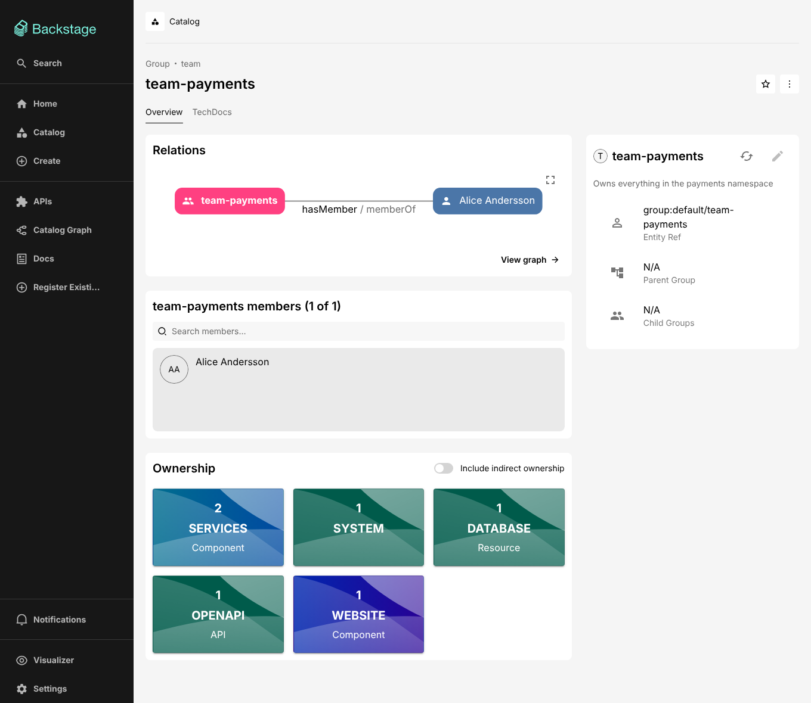
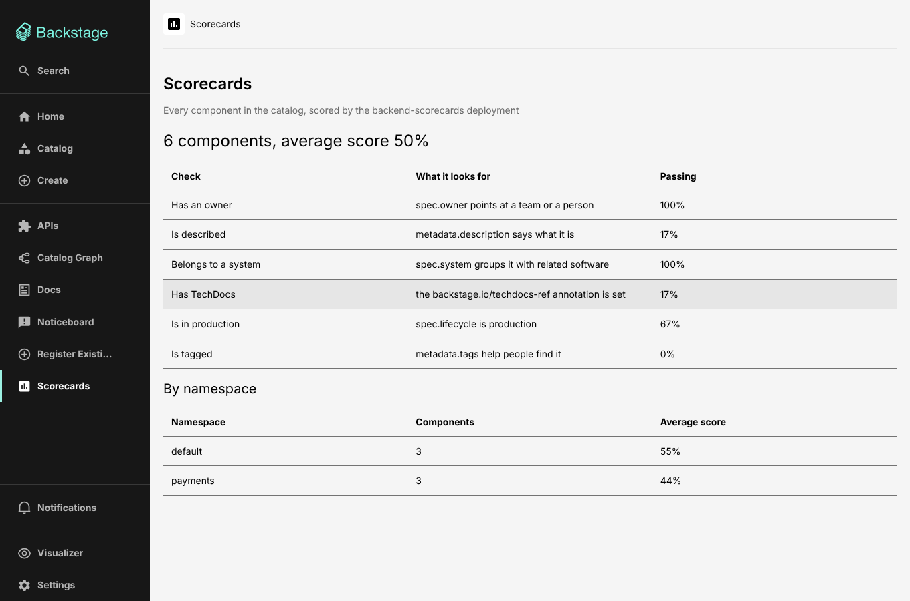
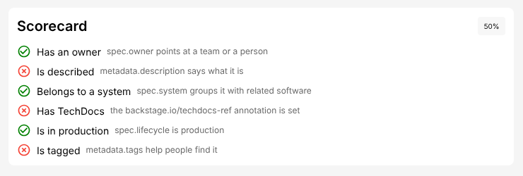

# Split Backstage deployment: plan, design and findings

This document explains what the proof of concept in this repository does, why
it is built the way it is, what was measured, what does not work (yet), and
how to take it to production. The [README](../README.md) covers how to run it.

## 1. Summary

The goal was a Backstage deployment where each backend can be built, pushed
and scaled on its own, behind a single frontend container and an nginx entry
point, with fast builds as the main constraint. A second question was whether
the software catalog can be split across several catalog instances, with
requests routed to the right instance(s) from their parameters.

Both work, and both run end to end in this repository (Backstage 1.55):

- **Nine images, nine Dockerfiles, built and pushed independently**: six
  backends (`core`, `catalog`, `scaffolder`, `search`, `techdocs`,
  `scorecards`), a catalog router, the frontend (static files in nginx) and
  the gateway (nginx). Orchestrated with Task and Docker Compose.
- **Builds stay fast because each image only depends on its own inputs.** A
  code change rebuilds a backend image in about 3 s on top of a cached
  dependency layer. That layer is keyed on a lockfile pruned to the backend's
  own production dependencies, so bumping a dependency of one backend reruns
  the (roughly 40 s) dependency install for that backend only.
- **Each deployment scales on its own** and traffic follows new replicas,
  both at the gateway and between the catalog router and the shards.
- **The catalog is split into three shards by kind and namespace.** A catalog
  router reads each request (filters, entity refs, paths, cursors), sends it
  only to the shards that can hold matching entities, and merges results when
  more than one can. The catalog UI, search, TechDocs, the scaffolder and the
  permission framework all work unchanged on top of it.
- **Plugins written in the repository build the same way.** Two local
  plugins, each with a frontend and a backend part, are compiled into the app
  image and into the backend images that host them: one inside `core`, one as
  a deployment of its own. Each bundle is fingerprinted on the local packages
  it contains, so a plugin change rebuilds only the images that include it
  (section 7).
- **Every service is versioned and released on its own.** Each service's
  inputs (its code and the local packages it bundles, its resolved production
  dependencies, the build toolchain, the files its image copies) are
  fingerprinted and compared with the fingerprint of its last release. Only
  services whose inputs changed are rebuilt, versioned and released, locally
  with `task release:changed` or from CI (section 8).

The catalog part answers "can we route by query?" with _yes, but not in nginx
alone_. nginx handles explicit selection (`?shard=payments`). Routing on the
catalog's own query language, and answering queries that span shards, needs a
component that understands that language; that is the catalog router. Some
things do not cross shard boundaries, most visibly reverse relations; see
[section 6.8](#68-what-does-not-cross-shards).

## 2. Goals and constraints

| Goal                                            | How it is met                                                                                                                                                                                           |
| ----------------------------------------------- | ------------------------------------------------------------------------------------------------------------------------------------------------------------------------------------------------------- |
| Independently build multiple backend containers | One package and one Dockerfile per backend; images only copy their own bundle and dependency manifest                                                                                                   |
| A single frontend container                     | `packages/app`: the static bundle served by nginx, configured at container start                                                                                                                        |
| nginx as the routing entry point                | `gateway/`: all browser _and_ service-to-service traffic goes through it                                                                                                                                |
| Fast, independent builds                        | Host-side bundles, per-backend pruned dependency layers, tiny build contexts, Task fingerprints                                                                                                         |
| Scale backends independently                    | One Compose service (Kubernetes Deployment) per backend and per catalog shard; DNS-aware load balancing                                                                                                 |
| Query-based routing to split catalog instances  | Gateway `?shard=` routing plus the catalog router's query-based pruning and fan-out                                                                                                                     |
| Locally sourced plugins in both builds          | `plugins/`: frontend plugins compiled into the app bundle, backend plugins into the bundle and dependency layer of the backend that hosts them                                                          |
| Version and release services independently      | `task plan` and `task release:changed`: per-service fingerprints of code, resolved dependencies, toolchain and image inputs, compared with the release record in `deploy/releases.json`; the same in CI |
| Taskfile + Docker Compose orchestration         | `Taskfile.yml`, `docker-compose.yml`                                                                                                                                                                    |

Non-goals for the POC: production authentication (it uses the guest
provider), a real permission policy (allow-all), Kubernetes manifests, and a
CI pipeline. Section 11 covers those.

## 3. Architecture

### 3.1 Services

| Service                                              | Image                   | Hosts                                                                                                                                   | Scales with                                                |
| ---------------------------------------------------- | ----------------------- | --------------------------------------------------------------------------------------------------------------------------------------- | ---------------------------------------------------------- |
| `gateway`                                            | nginx                   | Routing only                                                                                                                            | Connections; stateless                                     |
| `app`                                                | nginx + static files    | The frontend bundle                                                                                                                     | Rarely needs to; stateless                                 |
| `backend-core`                                       | Node                    | auth, permission, events (bus), proxy, notifications, signals, user-settings, kubernetes, mcp-actions, and the local noticeboard plugin | Permission checks (every request to every plugin calls it) |
| `catalog-router`                                     | Node, no `node_modules` | `/api/catalog` routing and merging                                                                                                      | Catalog request rate; stateless                            |
| `catalog-org`, `catalog-payments`, `catalog-default` | `backend-catalog`       | One catalog shard each                                                                                                                  | Read rate (replicas) and catalog size (shards)             |
| `backend-scaffolder`                                 | Node                    | Software templates                                                                                                                      | Concurrent template runs                                   |
| `backend-search`                                     | Node                    | Search API, Postgres engine, collators                                                                                                  | Query rate                                                 |
| `backend-techdocs`                                   | Python + Node           | TechDocs (serving and MkDocs generation)                                                                                                | Doc views and builds                                       |
| `backend-scorecards`                                 | Node                    | The local scorecards plugin                                                                                                             | Scoring requests, each of which reads the catalog          |
| `postgres`                                           | postgres                | One database per plugin (and per shard)                                                                                                 | (shared in the POC)                                        |

The split follows how the plugins behave under load: the catalog is read
heavy and the biggest dataset, the scaffolder is bursty and CPU heavy,
TechDocs needs a different runtime, and the small identity and platform
plugins stay together in `core`. `backend-scorecards` shows a plugin written
in this repository getting a deployment of its own (section 7).

### 3.2 How the pieces find each other

Every backend uses the same discovery config:

```yaml
discovery:
  endpoints:
    - target:
        internal: ${INTERNAL_GATEWAY_URL}/api/{{pluginId}} # http://gateway:8080
        external: ${BACKEND_BASE_URL}/api/{{pluginId}}
      plugins: ['*']
```

So a backend calling another plugin (search reading the catalog, the catalog
asking `permission`, `auth` looking up a user) goes through the gateway, which
maps `/api/<plugin>` to the deployment that hosts it. Consequences:

- **The gateway config is the only topology map.** Moving a plugin from
  `core` to its own deployment is a new Dockerfile and one nginx `location`.
- **Internal traffic is load balanced by nginx**, which re-resolves service
  names every 5 s (`server ... resolve`, nginx 1.27.3+), so scaled replicas
  get traffic immediately.
- The browser uses the same URLs (`backend.baseUrl` is the gateway), so there
  is no CORS and one TLS endpoint.

Everything not routed elsewhere falls through to `core` (`location /api/`),
which keeps the gateway config short.

### 3.3 What has to work across deployments

Splitting Backstage is mostly about the things a single process used to get
for free:

- **Service-to-service auth.** Plugins call each other with _plugin tokens_
  signed by the caller. The receiver verifies them against the caller's JWKS,
  which it fetches from `<caller base URL>/.backstage/auth/v1/jwks.json`
  through discovery, i.e. through the gateway. This works across deployments
  without shared secrets. (For the sharded catalog see 6.6.)
- **User tokens** are issued by `auth` in `core` and verified everywhere
  against its JWKS, also via the gateway.
- **Permissions**: with the framework on, each catalog read makes the catalog
  shard call `permission` in `core` on behalf of the user. The smoke test
  exercises this path on every catalog request.
- **Events**: in-process event delivery does not reach other deployments, so
  `core` runs the events backend (a Postgres-backed event bus) and every
  backend sets `events.useEventBus: always`. The default, `auto`, permanently
  falls back to process-local events if its first subscription gets a 404,
  which happened here whenever a backend started before `core`.
- **Databases**: each plugin gets its own database on the shared server, and
  each catalog shard sets its own `backend.database.prefix`, so the shards are
  fully independent catalogs.

### 3.4 Configuration layering

- `app-config.yaml` and `app-config.production.yaml` are baked into every
  backend image; environment-specific values come from environment variables.
- Per-deployment config is mounted into `/app/config.d/` and applied in name
  order by the shared entrypoint (`docker/backend-entrypoint.sh`). This is how
  one catalog image becomes three shards, and it maps directly onto Kubernetes
  ConfigMaps.
- The frontend image injects `app.baseUrl` and `backend.baseUrl` into
  `index.html` at container start (a `<script type="backstage.io/config">`
  tag, which the frontend reads at boot and which overrides the config baked
  in at build time). The same image therefore runs in every environment.

### 3.5 Databases, and giving services servers of their own

Every plugin already has a database of its own (`backstage_plugin_<id>`), and
every catalog shard is a complete catalog with its own databases (its
`backend.database.prefix`, e.g. `backstage_shard_payments_catalog`). No plugin
reads another plugin's database: they talk over HTTP, through the gateway.
The things that look shared are per plugin too: each plugin keeps its own
scheduler locks, its own service-to-service signing keys and its own
migrations, and the event bus is reached over HTTP like any other plugin.

So putting a service on a database server of its own is configuration: the
`backend.database.connection` of that deployment (here its `POSTGRES_HOST`),
or `backend.database.plugin.<pluginId>.connection` for one plugin inside a
deployment. `task up DATABASES=dedicated` adds
`docker-compose.databases.yml` and moves three deployments:

| Server                | Databases                                                                    |
| --------------------- | ---------------------------------------------------------------------------- |
| `postgres-payments`   | the `payments` shard's catalog: the `payments` namespace                     |
| `postgres-catalog`    | the `org` and `default` shards' catalogs                                     |
| `postgres-scaffolder` | the scaffolder                                                               |
| `postgres`            | everything else: auth, events, search, notifications, the local plugins, ... |

With that, the stack started in about 30 s, every smoke check passed on the
first run, and each server held exactly the databases above (the catalogs
re-ingested their 8, 7 and 9 entities from their locations).

How hard each kind of split is:

| Split                                                              | Effort         | How                                                                                                                                             |
| ------------------------------------------------------------------ | -------------- | ----------------------------------------------------------------------------------------------------------------------------------------------- |
| A deployment on its own server (scaffolder, search, core, ...)     | Low            | Its database connection; move the data with `pg_dump` / `pg_restore` while it is stopped                                                        |
| One plugin of a deployment on its own server                       | Low            | `backend.database.plugin.<pluginId>.connection`                                                                                                 |
| A catalog shard (a namespace, or a set of kinds) on its own server | Low            | The shard's connection. Its catalog can also rebuild from its sources; only locations registered through the API live nowhere else              |
| One catalog's data across several servers                          | Not supported  | The catalog joins and transacts across its tables in one database. Split it into shards instead (section 6), which is what this repository does |
| Read replicas for the catalog                                      | Medium to high | A read-only catalog deployment on a Postgres replica, and the router sending reads to it (below)                                                |

The catalog, the case that looks hardest, is therefore the easy one here: the
sharding in section 6 already split its data by namespace and kind, so each
part can live on any server. What stays hard is scaling reads of one shard
beyond what its primary database can serve. Backstage has the switches for a
read-only catalog: `catalog.processingInterval: false` (no processing loop),
`catalog.readonly: true` (no writes through the API),
`backend.database.skipMigrations: true`, and static service-to-service keys
(`backend.auth.pluginKeyStore`) instead of keys stored in the database. Such a
deployment could serve a streaming replica, with the catalog router sending
reads to it and writes to the primary. This was not built or tested here, and
it brings replication lag: a client that registers a location and reads it
straight back may not see it yet.

The costs of more servers are operational: each one to run, patch, back up,
monitor and size; credentials per server; and connection limits, since every
plugin of every replica holds a pool (5 here). A connection pooler such as
PgBouncer in front of each server helps once replicas multiply.

### 3.6 CI access with OIDC tokens

CI jobs read the catalog with the short-lived OIDC token their CI platform
issues them, so nothing is shared with CI. The catalog shards accept these
tokens through Backstage's external access (`deploy/external-access.yaml`,
mounted into the shards only) with `jwks-claims`, a token type this
repository adds (`packages/backend-catalog/src/ciAccess.ts`, registered
through `externalTokenHandlersServiceRef`). A shard that receives such a
token checks it as the built-in `jwks` type does: its signature against the
issuer's public keys, fetched once and cached, then issuer, audience,
algorithm and expiry. Then it checks the claims the config requires. The
caller becomes the service principal `external:ci:<sub>`, e.g.
`external:ci:repo:rgardam/rgardam:ref:refs/heads/main` in GitHub's case,
which the catalog's audit log records.

The claims are what makes a shared issuer safe. GitHub's signs tokens for
every repository on GitHub, and each workflow chooses its own audience, so
the built-in check alone accepts any workflow anywhere. `jwks-claims`
requires `repository_owner_id` here (857801, the `rgardam` account): an ID,
because an account name can be given up and registered by someone else. It
also requires issuer and audience, which the built-in type leaves optional,
and refuses to start without a claim to check. A refused token is logged with
the claim that failed, and answers 401 like any token the backend does not
know.

`accessRestrictions` limit accepted tokens to the catalog's read permissions,
so catalog writes answer 403. The permission policy is never consulted for
service principals: Backstage decides from the restrictions alone, so they
are the whole of CI's permissions. No other backend loads the config, so the
rest of the API refuses CI tokens outright. Through the router, a CI token
behaves like any other: each shard it reaches checks it.

Locally, `ci-oidc` (`docker/ci-oidc/server.mjs`, run from the stock
`node:24-alpine` image) stands in for GitHub's token service, with the same
interface (`ACTIONS_ID_TOKEN_REQUEST_URL` and `_TOKEN`) and claims. Like
GitHub's, it signs for several repositories: each request token in
`docker/ci-oidc/jobs.json` is a job in one, two of them in repositories the
catalog must refuse. `scripts/ci-catalog-read.mjs` runs unchanged locally
(`task ci:read`) and in GitHub Actions (`.github/workflows/catalog-read.yml`).
Pointing the deployment at GitHub is three variables, `CI_OIDC_ISSUER`,
`CI_OIDC_JWKS_URL` and `CI_OIDC_AUDIENCE`, plus the owner ID in the config.

## 4. Fast, independent builds

### 4.1 Pipeline

```
yarn install (once)  ->  per package: bundle on the host  ->  thin docker build  ->  push
```

1. **Bundle on the host** (`task bundle:<pkg>`): `backstage-cli package build`
   compiles the package and packs it into `dist/bundle.tar.gz`, plus a
   _skeleton_ listing the workspace `package.json` files it needs. This reuses
   the host's warm `node_modules` and build caches, which a from-scratch
   in-Docker build cannot. Task fingerprints the sources of the package and
   of every local package it bundles (7.4), so unchanged bundles are skipped
   in about 0.1 s.
2. **Prune the lockfile** (`scripts/prune-lockfile.mjs`, part of the bundle
   task): writes `dist/deps/`, with the root manifest, the backend's
   manifests _without devDependencies_, and a `yarn.lock` pruned to exactly
   those dependencies (`yarn install --mode=update-lockfile`, about 1.5 s, no
   downloads). Pruned lockfiles are 6.8k to 9.3k lines; the shared one is 33.4k.
3. **Thin image build**: copy `dist/deps/`, run
   `yarn workspaces focus --all --production` (with a BuildKit cache mount for
   the download cache), then copy config and unpack the bundle.

The dependency layer is the expensive one (25 to 40 s per backend, see 4.3)
and it is keyed on `dist/deps/` only. Without pruning, it would be keyed on
the shared root `yarn.lock`, and any dependency change anywhere in the
monorepo, including a dev tool upgrade, would rerun it in every backend
image. This was checked directly: adding a plugin module to
`backend-scaffolder` changed the root lockfile, and only the scaffolder image
reran its install (36 s); the other four reused their cached layers. Removing
a devDependency from `backend-catalog` left its own dependency layer cached.

Other choices that keep builds small:

- **Per-Dockerfile ignore files** (`<Dockerfile>.dockerignore`): each build
  context contains only what that image copies, so builds never ship the
  monorepo to the daemon.
- **Images that need no dependency install at all**: the catalog router has no
  runtime dependencies (the shared shard rules are inlined at build time via
  Backstage's `inline` packages), the frontend is static files, and the
  gateway is one config file.
- **Only the image that needs a toolchain gets it**: TechDocs starts from the
  official Python image and copies the Node binary in, so no image runs apt
  and the other backends carry no Python.
- **One parallel command**: `task build` runs all bundles and image builds
  concurrently; each image is also a target of its own (`task image:<svc>`).
- **pnpm-like Yarn settings** (4.4): dependencies' install scripts only run
  when allowlisted, and host installs hardlink files from one store per
  machine instead of copying them.
- **Stable digests**: images are built with `--provenance=false`. With
  BuildKit's default provenance attestation, every build produced a new image
  digest even when every layer came from the cache, so every service looked
  changed: Compose would recreate all containers, and pushes would upload new
  manifests for unchanged services. Now an unchanged service keeps its digest.
  `DOCKER_BUILD_FLAGS=--provenance=mode=max` turns attestations back on.
- **A reproducible frontend image**: the frontend build writes
  `.config-schema.json` in a different order each time. Only a Node app
  backend reads that file, so the app image leaves it out, and an unchanged
  frontend keeps its digest too.

### 4.2 CI shape

The same tasks map onto CI without changes:

1. `task install`, `task check` (type-check and unit tests).
2. Work out which services changed since their last release and release only
   those: `task release:changed REGISTRY=...` (section 8).
   `.github/workflows/release.yml` shows the plan on every pull request that
   touches the project, and releases on demand.
3. Persist BuildKit cache between runs, e.g.
   `DOCKER_BUILD_FLAGS="--cache-from type=registry,ref=<repo>:cache --cache-to type=registry,ref=<repo>:cache,mode=max"`
   (needs a buildx builder with the `docker-container` driver).
4. Bring the stack up from the pushed tags and run `task smoke` and `task e2e`.

### 4.3 Measurements

Measured on a 4 vCPU, 15 GB cloud container with Docker 29 (containerd image
store) and BuildKit, building one image at a time. Each time is the host
bundle plus the image build, the same commands `task image:<svc>` runs.

- **Cold**: no bundle and an empty BuildKit cache, including the yarn and pip
  download caches. Base images were already pulled, as they usually are on CI
  runners.
- **Code change**: one source file of the image's package edited; the
  dependency layer is cached.
- **Dependency change**: the image's pruned dependency manifest changed, so
  the dependency install reruns with a warm download cache. Image build only;
  the bundle that produces the new manifest adds about 4 s.
- **Nothing changed**: `task image:<svc>` with everything up to date.

| Image                | Cold                | Code change       | Dependency change  | Nothing changed |
| -------------------- | ------------------- | ----------------- | ------------------ | --------------- |
| `backend-core`       | 60 s (4.1 + 55.8)   | 7.6 s (5.1 + 2.5) | 39.7 s             | 2.1 s           |
| `backend-catalog`    | 43 s (4.6 + 38.6)   | 7.5 s (4.9 + 2.6) | 29.0 s             | 1.5 s           |
| `backend-scaffolder` | 45 s (3.8 + 41.2)   | 7.6 s (5.1 + 2.5) | 31.6 s             | 1.6 s           |
| `backend-search`     | 45 s (3.7 + 41.5)   | 7.0 s (3.9 + 3.1) | 32.8 s             | 1.5 s           |
| `backend-techdocs`   | 119 s (3.8 + 115.5) | 7.9 s (5.4 + 2.5) | 32.7 s             | 1.5 s           |
| `backend-scorecards` | 39 s (3.9 + 34.7)   | 6.1 s (3.8 + 2.3) | 25.3 s             | 1.6 s           |
| `catalog-router`     | 15 s (2.8 + 11.8)   | 4.1 s (2.8 + 1.3) | nothing to install | 1.5 s           |
| `app`                | 25 s (12.4 + 12.7)  | 21 s (14.6 + 6.4) | part of the bundle | 2.1 s           |
| `gateway`            | 4.7 s (no bundle)   | 1.4 s             | nothing to install | 1.4 s           |

Times in brackets are bundle + image.

For the whole stack and for operations:

| What                                                                            | Time     |
| ------------------------------------------------------------------------------- | -------- |
| All 9 images from cold, in parallel (`task build`)                              | 2 m 12 s |
| All 9 images, nothing changed (`task build`)                                    | ~4 s     |
| Router code change to new router serving traffic (`task deploy:catalog-router`) | 12 s     |
| Dependency added to one backend: that image rebuilt, the rest cached            | 36 s     |
| Stack start from images, 12 containers healthy (`task up`)                      | ~16 s    |
| Add two replicas to a deployment (`task scale`)                                 | ~6 s     |

The router deploy, dependency and scaling rows were measured before the local
plugins were added; nothing they depend on has changed since.

Where the time goes:

- **A cold backend image** (`backend-core`, 56 s) spends about 9 s preparing
  the base image, 19 s installing dependencies, and 22 s writing the result:
  compressing the roughly 500 MB `node_modules` layer (15 s) and unpacking it
  into Docker's image store (8 s). A dependency change skips the base image
  and saves about 5 s of downloads, so it costs 25 to 40 s. Pruning keeps
  this off the common path; a code change only adds a few MB on top.
- **TechDocs** adds about 70 s when cold, for installing MkDocs with pip.
  That layer comes before the Node dependencies, so it reruns only when the
  MkDocs version changes.
- **The frontend** takes 12 to 15 s to bundle and 6 to 13 s to copy its
  67 MB of static files into the image. The very first bundle after a
  machine restart took 43 s (and the first backend bundle 25 s instead of
  4 s), because `node_modules` was not in the OS file cache yet. A fresh CI
  runner sees the same.
- **In parallel**, the nine cold builds take 2 m 12 s instead of the 6.5 min
  they add up to; TechDocs is the long pole.

### 4.4 Yarn, configured like pnpm

pnpm was evaluated as a replacement for Yarn. Built with pnpm, the backend
images ran the whole stack correctly, and pnpm installed dependencies about
twice as fast. But compressing and storing the `node_modules` layer, which
takes as long as the install, did not change, so an image rebuilt after a
dependency change was only about 11% faster, and code-change rebuilds do not
install at all. The Backstage tooling assumes Yarn: the CLI finds the
repository root through Yarn's `workspaces` field, backend bundles copy
`yarn.lock`, and `backstage-cli versions:bump`, the upgrade path, reads
`yarn.lock` and runs Yarn. A pnpm monorepo needed five workarounds and lost
`versions:bump`.

So the repository keeps Yarn, with the two pnpm behaviours that mattered:

- **Dependencies' install scripts do not run** unless allowlisted, as in
  pnpm 10: `enableScripts: false` in `.yarnrc.yml`, and `dependenciesMeta` in
  the root `package.json` (`better-sqlite3`, which the backend tests need).
  The 16 scripts that no longer run were a telemetry ping, install
  banners, checks for platform binaries that are installed anyway, and
  optional native builds. Type checks, unit tests, lint, bundles, the smoke
  and browser tests all pass without them, as the stack did with pnpm images
  that skipped the same scripts. Images use the same allowlist: the pruned
  root manifest they install from carries `dependenciesMeta`.
- **Host installs hardlink files from one store per machine**
  (`nmMode: hardlinks-global`), like pnpm's store, instead of copying about
  2 GB into `node_modules`. Images copy (`YARN_NM_MODE=classic`): a hardlink
  cannot point from an image layer into the build cache.

Measured on the machine from 4.3, whole-repository installs from an empty
`node_modules` with a warm package cache:

| Configuration                                          | Install     |
| ------------------------------------------------------ | ----------- |
| Yarn as it was (copies files, runs 17 install scripts) | 65 to 115 s |
| Yarn with allowlisted scripts and hardlinks            | 29 to 30 s  |
| pnpm, for comparison                                   | 10 to 12 s  |

In images, an install after a dependency change took 13.5 s on average with
the scripts and 11.5 s without (pnpm: 7.3 s), out of 35 to 40 s for the whole
image build.

## 5. Scaling

Every deployment scales independently:
`task scale SERVICE=catalog-default REPLICAS=3` locally, a replica count or
HPA per Deployment in Kubernetes.

**Why replicas are safe.** Backstage keeps coordination state in Postgres: the
scheduler takes task locks in the plugin database, catalog processing claims
entities in the shard's database, and the event bus is Postgres backed. The
replicas of one deployment share their database; deployments do not share
anything but the server.

**Load balancing.** Two places balance traffic, and both follow replicas as
they come and go:

- _Gateway_: one upstream per deployment, `least_conn`, names re-resolved
  every 5 s. With two search replicas, 20 requests split 10/10.
- _Router to shards_: the router connects to shards directly. Plain DNS plus
  keep-alive pinned _all_ traffic to the replica that existed when the
  connection opened (30 of 30 lookups hit replica 1 after scaling to three).
  The router now resolves every replica address (5 s TTL), picks one per
  request round-robin and keeps a keep-alive pool per replica. The same 30
  lookups split 11/9/10. A request that fails to connect (a replica that just
  went away) is retried once on another replica; scaling back down to one
  replica under traffic produced no failed requests.

**Caveats** that matter once replicas > 1:

- TechDocs with the `local` publisher keeps generated sites on local disk, so
  replicas do not share them. Production should use the `external` builder
  (generate in CI) and object storage.
- The scaffolder runs tasks in a local working directory; it is fine with
  replicas (tasks are claimed from the database) but needs disk sized for it.
- Signals keeps websockets open on `core`; the event bus fans signals out to
  all replicas.
- Many small connection pools: every plugin of every replica holds one. The
  POC caps pools at 5 and raises Postgres `max_connections`; production should
  add PgBouncer or split databases.

## 6. Catalog sharding by query parameters

### 6.1 Can nginx do it alone?

Partly. nginx can route on query parameters, and the gateway does exactly
that for explicit selection: `?shard=payments` (or
`X-Catalog-Shard: payments`) goes straight to that shard, and the gateway
strips the parameter first, because the catalog's request validator rejects
unknown parameters with a 400.

Routing on the catalog's _own_ parameters does not fit in nginx config:

- Filters are a small language: `filter=kind=component,metadata.namespace=payments`
  with repeated `filter` parameters OR-ed, keys and values case-insensitive,
  and values URL-encoded. nginx's `$arg_filter` only sees the first one.
- Some requests carry their routing data in a JSON body
  (`POST /entities/by-refs`, predicate queries), and follow-up pages carry it
  in an opaque cursor.
- Many requests legitimately span shards (the catalog table lists every
  component), and the answer must be one merged, sorted, paginated response.

So the gateway does the explicit part, and a small **catalog router** that
understands the catalog API does the rest.

### 6.2 Topology and ownership

`deploy/catalog-shards.json` is read by the router and by every shard:

<!-- prettier-ignore -->
```json
{ "catalogSharding": { "shards": [
  { "name": "org",      "target": "http://catalog-org:7007/api/catalog",      "match": { "kinds": ["User", "Group"] } },
  { "name": "payments", "target": "http://catalog-payments:7007/api/catalog", "match": { "namespaces": ["payments"] } },
  { "name": "default",  "target": "http://catalog-default:7007/api/catalog" }
], "localKinds": ["Location"] } }
```

An entity belongs to the **first** shard whose rule matches its kind and
namespace; the last shard is a catch-all. People and teams are in `org` even
when namespaced `payments`. `Location` entities are _local_: every shard
creates them for its own registered locations, so they may be in any shard.

The rules live in one place, `packages/catalog-sharding`, which both the
router and the catalog backend inline at build time.

**Ownership is enforced, not assumed.** Each shard runs a small processor
(`packages/backend-catalog/src/shardGuard.ts`) that rejects entities owned by
another shard, with an error naming the right one. Routing relies on this
invariant: if an entity could appear in a shard the rules say it is not in,
pruning would silently miss it.

### 6.3 Pruning

For each request the router computes the set of (kind, namespace)
combinations that matching entities can have, as a list of alternatives. It
handles legacy filters, filter predicates (`$all`, `$any`, `$in`; `$not` and
unknown operators widen to "anything"), entity refs and paths. Then, for each
alternative, it walks the rules in order, keeps every shard whose rule _may_
match, and stops at the first one that _must_ match (first match hides the
rest). A query that may touch local kinds goes to every shard.

| Request                                                         | Shards            |
| --------------------------------------------------------------- | ----------------- |
| `filter=kind=group`                                             | org               |
| `filter=kind=component`                                         | payments, default |
| `filter=kind=component,metadata.namespace=payments`             | payments          |
| `filter=kind=user,metadata.namespace=payments`                  | org               |
| `entities/by-name/component/payments/ledger`                    | payments          |
| `filter=kind=group&filter=kind=api,metadata.namespace=payments` | org, payments     |
| `filter=metadata.namespace=payments` (no kind)                  | all three         |
| `facet=kind` (no filter)                                        | all three         |

The extraction is deliberately conservative: it may include a shard that
turns out to have nothing, but never skips one that could have results.

### 6.4 How each endpoint is served

| Endpoint                                                                   | Strategy                                                                                       |
| -------------------------------------------------------------------------- | ---------------------------------------------------------------------------------------------- |
| `GET /entities/by-name/...`, `.../ancestry`, `/locations/by-entity/...`    | The owner from the path; streamed straight through                                             |
| `GET` and `POST /entities/by-query`                                        | Pruned; one shard is streamed through (cursors wrapped), several are merged page by page (6.5) |
| `GET /entities` (legacy list; the Ownership card and older clients use it) | Pruned; merged and sorted; `limit`/`offset`/`after` applied after the merge                    |
| `GET` and `POST /entity-facets`                                            | Pruned; counts summed per value                                                                |
| `POST /entities/by-refs`                                                   | Refs split by owner, one request per shard, answers put back in request order                  |
| `GET`/`DELETE /entities/by-uid/:uid`, `/locations/:id`                     | Asked of every shard; first success wins                                                       |
| `POST /refresh`, `/validate-entity`, permission `apply-conditions`         | Routed to the owner taken from the body                                                        |
| `POST /locations`                                                          | Dry run on every shard; registered on the one whose guard accepts all the entities (6.7)       |
| `GET /.backstage/auth/v1/jwks.json`                                        | Union of every shard's keys (6.6)                                                              |
| Anything else (OpenAPI spec, analyze-location, actions)                    | Catch-all shard                                                                                |

Every response from the router carries `x-catalog-route` (`single`, `fanout`,
`pinned`, or `default` for the catch-all row) and `x-catalog-shards`, and the
gateway logs both; requests the gateway sends straight to a shard (`?shard=`)
carry neither. Watching the catalog UI shows the pruning working:
`facet=spec.type&filter=kind=component` touches two shards, a group page's
lookups touch only `org`.

### 6.5 Pagination across shards

`/entities/by-query` pages with opaque cursors, and the catalog UI uses it for
the main table, the owner picker and counts; the search collators page
through the whole catalog with it. The router keeps paging consistent:

- **One shard**: the shard's cursor is wrapped with the shard's name, so the
  next page goes back to the same shard.
- **Several shards**: each page is a k-way merge of a window from every
  shard. The cursor records, per shard, how many items earlier pages used, so
  the next page asks each shard for `limit` items from its own offset.
  `totalItems` is the sum. A previous page is rebuilt by merging the `limit`
  items before each shard's offset and keeping the last `limit`.
- The merge always takes from the head of each shard's list, so every shard is
  consumed in its own order even if the router's comparator disagreed with a
  shard. That is what makes paging gap and duplicate free in both directions;
  the router's tests check it page by page.
- Cursors stay base64 JSON. `CatalogClient` decides between GET and POST for
  the next page by looking for a `query` key in the decoded cursor, so router
  cursors carry one exactly when the original request was a POST.

Ordering matches a single catalog: the comparator reproduces the catalog's SQL
ordering (lowercased values, entity id as tie breaker, entities missing the
sort field excluded or sorted last, depending on the endpoint). Postgres runs
with `C` collation so string order is byte order on both sides. With another
collation, merged pages would still never skip or repeat an entity; the
interleaving could just differ slightly for punctuation.

Offsets assume the result set is stable while paging. The catalog's own
keyset cursors tolerate concurrent writes better; under heavy churn a merged
page can shift by an item.

### 6.6 Auth across shards

Each shard signs plugin tokens with its own keys, stored in its own database.
A plugin verifying a token from "the catalog" fetches the JWKS from the
catalog's base URL, which is the router, so the router serves the **union of
all shards' keys**. Without this, permission checks would fail whenever the
verifier's JWKS request reached a different shard than the one that signed.
An alternative is a shared static key pair for all shards
(`backend.auth.pluginKeyStore`), which removes the fan-out at the cost of key
distribution.

### 6.7 Writes

Most writes name their entity (`refresh`, `validate-entity`, deletes by uid)
and go to its owner. Registering a location is different: the owner depends on
what the file contains. The router dry-runs the registration on every shard,
and since each shard's guard rejects entities it does not own, exactly one
shard accepts a well-formed location. The router registers it there. A file
that mixes entities from different shards is rejected with the guard's error,
which names the owning shards. Clients that know the shard can say so with
`?shard=`.

### 6.8 What does not cross shards

The catalog computes relations while processing the entity that _declares_
them, and stores both directions in that entity's shard. `ledger` (payments)
declares `ownedBy: team-payments` (org), so `team-payments ownerOf ledger`
lives in the payments shard, and the group entity served by `org` does not
list it. In the UI:



- **Works**: anything that _queries_ by relation, because the query fans out.
  The Ownership card (`relations.ownedBy=group:default/team-payments`), owned
  entity counts, search, and every forward relation (`ledger` shows its owner,
  `service-gateway` its consumed API in another shard).
- **Missing**: reverse relations on the target entity when source and target
  are in different shards, e.g. `ownerOf` edges on the team's relation graph,
  `apiConsumedBy` on an API consumed from another shard, `hasPart` on a system
  whose components live elsewhere. Ancestry (`/ancestry`) is also per shard.

Choosing shard boundaries along relations keeps this small: teams own what is
in their namespace, and org data (users and groups) is referenced _from_
everything but declares few relations itself. Fixing it fully would mean
federating relations: either the router adds reverse relations at read time
(a relation query per entity read, cacheable), or shards exchange relation
edges through the event bus.

Other limits worth knowing:

- An unconstrained query touches every shard, and the unpaginated
  `GET /entities` is buffered in the router. Paginated endpoints are bounded.
- A failing shard fails fan-out requests (502, or the shard's own error)
  rather than returning partial results.
- Moving a namespace between shards is a re-registration, not a migration:
  change the rule, register the locations with the new owner, let the old
  shard's copies be orphaned and cleaned up.

### 6.9 Alternatives considered

- **nginx with njs scripting** for merging: possible, but the merge, cursor
  and partitioning logic is far easier to test as code; the router has
  unit and integration tests against fake shards.
- **Shard by kind only**: almost every request carries a kind, so routing is
  nearly always a single shard, but kinds do not match ownership boundaries
  and most relations would cross shards. The rule format supports both, and
  the demo topology mixes them on purpose.
- **A global read replica of the whole catalog** next to the shards: simple
  reads, but it re-centralizes the data and the processing load that sharding
  was meant to split.

## 7. Local plugins

Most Backstage installations run plugins written in-house next to those from
npm, so the builds have to handle both. `plugins/` holds two local plugins,
each with a frontend and a backend part, chosen to take different paths:

|                 | noticeboard                                                                                                       | scorecards                                                                                      |
| --------------- | ----------------------------------------------------------------------------------------------------------------- | ----------------------------------------------------------------------------------------------- |
| Frontend        | A page (`/noticeboard`) to post and read notices                                                                  | A card on every component's overview page, and a page (`/scorecards`) scoring the whole catalog |
| Backend         | Notices in the plugin's own database, with Knex migrations shipped in the package; posting needs a signed-in user | Reads entities through the catalog service and scores them; the summary streams every component |
| Shared code     | None                                                                                                              | `scorecards-common`: the checks, used by the backend to score and by the frontend to label      |
| Backend runs in | `backend-core`, an existing deployment                                                                            | `backend-scorecards`, a new deployment                                                          |



### 7.1 Frontend plugins: compiled into the one app image

- The frontend plugins are workspace packages that `packages/app` depends
  on. The app uses the new frontend system with `app.packages: all`, so the
  build discovers them among its dependencies and installs them; the app's
  code does not change. Each plugin's `title` and `icon` give it a sidebar
  entry, and the scorecard card is an `EntityCardBlueprint` extension that
  the entity page shows for components.
- They are compiled from TypeScript source together with the app (their
  `main` is `src/index.ts`), with no separate build or publish step. Pages
  and cards are loaded lazily, so their code sits in chunks of its own.
- They call their backends at `plugin://<pluginId>/...` through `fetchApi`,
  which resolves to `<backend.baseUrl>/api/<pluginId>`, i.e. the gateway. The
  frontend never knows which deployment hosts a plugin.

However many local frontend plugins there are, there is still one frontend
image.



### 7.2 Backend plugins: bundled with the backend that hosts them

A backend plugin is a dependency of the backend package that hosts it, plus
one `backend.add(import(...))` line. Nothing in the pipeline (4.1) is
specific to local plugins:

- `backstage-cli package build` on the backend builds every local package it
  depends on and packs each into the backend's `bundle.tar.gz`, the way
  `npm pack` would, so the package's `files` field decides what ships. The
  noticeboard plugin lists `migrations` there; in the container,
  `resolvePackagePath` finds them and the plugin migrates its database on
  start.
- The pruned lockfile keeps local packages as workspace entries with their
  production dependencies, so a plugin's npm dependencies are installed in
  the cached dependency layer of the images that host it. Only those images'
  lockfiles list the plugin: adding or bumping one of its dependencies
  reruns their dependency install and leaves every other image's cache
  alone.

At runtime a local plugin is wired like any other split plugin (3.3).
Scorecards shows the whole path: `backend-scorecards` reads the catalog with
a plugin token through the gateway and the catalog router, which fans the
summary query out to the two shards that hold components, and each shard
verifies the token against `/api/scorecards/.backstage/auth/v1/jwks.json`,
fetched through the gateway.

### 7.3 Where a backend plugin runs

- **In an existing deployment** (noticeboard in `core`): the dependency and
  the `backend.add`. No routing change, because the gateway sends every
  plugin it does not know to `core`. In any other deployment, add a gateway
  `location` for the plugin's id.
- **In a new deployment** (scorecards): `packages/backend-scorecards` is a
  `package.json`, a few lines of `index.ts`, and a Dockerfile and ignore file
  copied from another backend with the name changed. Then one compose
  service, one gateway upstream and `location`, and the image in the
  Taskfile's `build` and `push` lists.

The plugin is the same either way; moving it between deployments touches
only the host packages and the gateway. To add a plugin: `yarn new`, choose
`frontend-plugin` (it is added to `packages/app` and shows up with no further
change) or `backend-plugin`, then host it as above.

### 7.4 Rebuilding only what a plugin change affects

A bundle now contains more than its own package, so its Task fingerprint has
to as well. `scripts/workspace-deps.mjs` lists, for a package, its directory
and those of the local packages that go into its build: local runtime
dependencies, transitively, plus the inline packages it imports (nothing
declares those, so they are found by their imports). The bundle tasks
fingerprint `src/`, `package.json` and `migrations/` in each.

| Bundle                              | Local inputs                                                                             |
| ----------------------------------- | ---------------------------------------------------------------------------------------- |
| `app`                               | `packages/app`, `plugins/noticeboard`, `plugins/scorecards`, `plugins/scorecards-common` |
| `backend-core`                      | `packages/backend-core`, `plugins/noticeboard-backend`                                   |
| `backend-scorecards`                | `packages/backend-scorecards`, `plugins/scorecards-backend`, `plugins/scorecards-common` |
| `backend-catalog`, `catalog-router` | Their package and `packages/catalog-sharding` (inline, imported by both)                 |
| Every other bundle                  | Its package                                                                              |

Measured with `task build` after editing one source file, with everything
else cached, on the machine from 4.3 (wall time over two or three runs each,
including the up-to-date checks of the other services):

| File edited in                | Rebuilt                                 | Time       |
| ----------------------------- | --------------------------------------- | ---------- |
| `plugins/noticeboard-backend` | `backend-core` bundle and image         | 8 to 10 s  |
| `plugins/noticeboard`         | `app` bundle and image                  | 18 to 32 s |
| `plugins/scorecards-backend`  | `backend-scorecards` bundle and image   | 7 to 17 s  |
| `plugins/scorecards-common`   | `app` and `backend-scorecards` together | 22 to 23 s |

The times vary with the load on a shared machine; which images were rebuilt
never did. Every image not listed kept its exact digest, so `task up` leaves
those containers running. Three problems came up while measuring this, all
fixed:

- Digests changed on every build because of provenance attestations; builds
  now pass `--provenance=false` (4.1).
- The frontend bundle's `.config-schema.json` differs between builds; the app
  image leaves it out (4.1).
- Running `yarn workspace <backend> build` by hand replaces `dist/` without
  `dist/deps`, while Task still considers the bundle current, and the image
  build then fails. The bundle task now also checks that `dist/deps` exists.

## 8. Releasing services independently

Every service has its own version and is released only when something that
goes into its image changed: its code, its dependencies, the toolchain that
builds it, or the files its Dockerfile copies. A change to one backend
releases that backend and nothing else.

### 8.1 What counts as a change

`scripts/release.mjs` finds the deployable services (every
`packages/<name>/Dockerfile`, plus the gateway) and fingerprints each from
four inputs:

| Input        | Covers                                                                                                                             | Computed from                                                                                                                                                           |
| ------------ | ---------------------------------------------------------------------------------------------------------------------------------- | ----------------------------------------------------------------------------------------------------------------------------------------------------------------------- |
| Code         | The package and every local package that goes into its build: local dependencies, transitively, and the inline packages it imports | The files, minus tests, stories, docs, the plugin dev harness and lint config; `package.json` without its dependency fields. The frontend also embeds `app-config.yaml` |
| Dependencies | The production dependencies, as resolved                                                                                           | The lockfile pruned to them: for a backend, the file its image installs from (4.1); for the frontend, what it bundles                                                   |
| Toolchain    | The Backstage CLI that builds every bundle                                                                                         | The lockfile pruned to the root `@backstage/cli*` devDependencies                                                                                                       |
| Image        | What the Dockerfile copies besides the bundle                                                                                      | The Dockerfile, its `.dockerignore`, every path that file lets in (config, `examples/`, the Yarn release), and the `NODE_VERSION` build argument                        |

Because the dependency input is the resolved, pruned lockfile, a dependency
upgrade flags exactly the services whose installed dependencies change, even
though it changes the shared root `yarn.lock`. Because the image input is read
from each Dockerfile's `.dockerignore`, which lists exactly what may enter the
build context, a new `COPY` cannot be missed: it needs a new line there first.

What each kind of change flags (all checked by the tests in
`scripts/release.test.mjs`):

| Change                                                      | Services flagged                                            |
| ----------------------------------------------------------- | ----------------------------------------------------------- |
| Code in `plugins/noticeboard-backend` (or a new file there) | `backend-core`                                              |
| Tests, a README, or a plugin's `dev/` harness               | none                                                        |
| Code in the `scorecards` frontend plugin                    | `app`                                                       |
| `plugins/scorecards-common`                                 | `app`, `backend-scorecards`                                 |
| `packages/catalog-sharding` (inline)                        | `backend-catalog`, `catalog-router`                         |
| A dependency only `backend-search` uses                     | `backend-search`                                            |
| The Backstage CLI                                           | the eight images built from bundles, not the gateway        |
| `app-config.yaml`                                           | `app` and the six backends                                  |
| `app-config.production.yaml`                                | the six backends                                            |
| `examples/`                                                 | `backend-catalog`, `backend-scaffolder`, `backend-techdocs` |
| `gateway/default.conf.template`                             | `gateway`                                                   |
| One service's Dockerfile                                    | that service                                                |
| `NODE_VERSION=22`                                           | the seven Node.js images                                    |

The plan needs no install and no network: pruning runs Yarn against the
lockfile with the network off and platform-specific packages left out, so a
fresh clone with an empty Yarn cache computes exactly the same fingerprints.
Pruned lockfiles are cached by their inputs: a plan takes about 5 s cold and
0.4 s after that.

### 8.2 Versions and the release record

`deploy/releases.json` is the release record. For each service it holds the
version (semver), the fingerprint and the hashes of its four inputs, the build
arguments, and the commit it was released from. The record lives in git, so
what is released, and when it changed, is reviewable like code.

When the plan flags a service it also says why: the files changed since the
commit of its last release, the dependency versions that changed (by pruning
the lockfile as it was at that commit, too), the build argument that changed.

A release tags each image `<registry>/backstage-poc/<service>:<version>` and
labels it with `org.opencontainers.image.version`,
`org.opencontainers.image.revision` and `io.backstage-poc.inputs` (the
fingerprint). `task release:tag` adds a git tag `<service>@<version>`,
annotated with the fingerprint, for every recorded version.

### 8.3 Tasks

| Task                                | What it does                                                                                                                                                 |
| ----------------------------------- | ------------------------------------------------------------------------------------------------------------------------------------------------------------ |
| `task plan`                         | Which services changed since their last release, why, and their next versions. Also writes `dist/release-plan.json`                                          |
| `task build:changed`                | Build images for the changed services only, tagged with their next version                                                                                   |
| `task release:changed REGISTRY=...` | Build and push the changed services only, then record their new versions. Without `REGISTRY` the images stay local. `BUMP=minor` or `major` for bigger steps |
| `task release:tag`                  | Tag recorded versions in git, once `deploy/releases.json` is committed                                                                                       |
| `task up:released`                  | Run each service at its recorded version. Images missing locally are built from source when their source still matches the release                           |

Measured on the stack in this repository, after editing a file in the
noticeboard plugin: `task plan` flagged `backend-core` only,
`task release:changed` built `backend-core:1.0.1` in 8.5 s (19.5 s end to
end), and `task up:released` replaced the `backend-core` container while the
other eleven kept running. Releasing a frontend plugin change with
`REGISTRY=localhost:5000 BUMP=minor` built and pushed `app:1.1.0` only.

A release fails as a whole: if any build or push fails, nothing is recorded.
It also refuses to record a service whose inputs changed while it was being
built.

### 8.4 CI

`.github/workflows/release.yml` runs the plan on every pull request that
touches `backstage-split-backends/` and puts it in the job summary; the job needs only Node.js and a checkout. Run by hand,
it releases the changed services to GHCR, commits `deploy/releases.json` and
pushes the tags. To release on every merge instead, trigger it on pushes to
the main branch; the release job already skips when nothing changed. The plan
also writes the list of changed services to the job's outputs, for a build
matrix with one job per service.

### 8.5 Limits

- Base images are referenced by tag (`node:24-trixie-slim`), so a rebuilt
  base image is not a change. Pinning digests (and letting a bot bump them)
  would make base image updates show up as image changes.
- Configuration mounted at deploy time (`deploy/catalog/*.yaml`,
  `deploy/catalog-shards.json`) belongs to the deployment, not to any image,
  and is not versioned with the services.
- Each release run bumps every changed service by the same step (`BUMP`).
  Choosing per service would need conventional commits or changesets.
- Fingerprints cover the working tree, uncommitted changes included. CI
  releases from a clean checkout; locally, `release:changed` warns when the
  tree is not clean.
- Changing what a fingerprint covers changes every fingerprint, so the next
  plan flags every service once. The fingerprint format is versioned for that.
- Development builds (`task build`, tag `dev`) still rebuild every backend
  bundle when the root lockfile changes, because backstage-cli copies the
  whole lockfile into each bundle. Releases are unaffected: unchanged services
  are not rebuilt.

## 9. Configuration reference

**Adding a catalog shard** (say `platform` for a `platform` namespace):

1. `deploy/catalog-shards.json`: add the shard _before_ the catch-all, with a
   `target` and a `match` rule.
2. `deploy/catalog/platform.yaml`: `catalogSharding.self`, a database prefix,
   and its `catalog.locations` and `catalog.rules`.
3. `docker-compose.yml`: a service from the `backend-catalog` image like the
   existing shards, mounting both files and `deploy/external-access.yaml`;
   without that one, CI requests that reach the new shard fail.
4. Restart the router and every shard: they read the topology at startup.
5. Optionally, for `?shard=platform`: an upstream and a line in each shard map
   in `gateway/default.conf.template`, which means a new gateway image.

No catalog image needs rebuilding.

**Adding a service**: a new `packages/<name>/Dockerfile` (with its
`.dockerignore`) is picked up by the release plan on its own and released at
1.0.0 the first time. In `docker-compose.yml`, tag its image with
`${<NAME>_TAG:-${TAG:-dev}}` so `task up:released` can set its version.

**Environment variables** used by the backends: `APP_BASE_URL`,
`BACKEND_BASE_URL`, `INTERNAL_GATEWAY_URL`, `POSTGRES_HOST`, `POSTGRES_PORT`,
`POSTGRES_USER`, `POSTGRES_PASSWORD`, `GITHUB_TOKEN` (optional),
`LOG_LEVEL`, and for CI access (3.6) `CI_OIDC_ISSUER`, `CI_OIDC_JWKS_URL` and
`CI_OIDC_AUDIENCE`. The router reads `CATALOG_SHARDS_FILE`, `PORT`,
`CATALOG_BASE_PATH`, `SHARD_TIMEOUT_MS` and `LOG_LEVEL`. The frontend image
reads `APP_BASE_URL` and `BACKEND_BASE_URL`.

**Task variables**: `REGISTRY`, `IMAGE_NAMESPACE`, `TAG`, `NODE_VERSION`,
`EXTRA_CA_CERT` (CA for TLS-intercepting proxies, passed to builds as a
secret), `DOCKER_BUILD_FLAGS`, `APP_BASE_URL`, and `BUMP` (`patch`, `minor`
or `major`, for `release:changed`).

## 10. Testing

- `task check`: type-check, the release detection tests below, and 66 unit
  tests, including shard pruning, the
  guard, and router integration tests against in-process fake shards (paging
  forward and back without gaps, ordering, field projection, POST cursors,
  by-refs reassembly, JWKS union, pinning, shard outages). The `jwks-claims`
  CI token check is tested against a JWKS served in the test: tokens from
  another owner, a reused owner name, a missing or unlisted claim, another
  key, issuer or audience, and config it must refuse to start with. The plugins have
  their own: backend routers in a test backend (noticeboard on in-memory
  SQLite with its real migrations, scorecards with a mock catalog), and
  frontend pages and cards against mocked HTTP.
- `node --test scripts/*.test.mjs` (part of `task check`, about 20 s): the
  release plan in a temporary git worktree, with one kind of change at a time
  (code, tests and docs, a shared library, an inline package, config, a
  Dockerfile, a dependency, the toolchain, the Node.js version) and exactly
  the services each must flag.
- `task smoke`: 26 checks against the running stack, covering the gateway, the
  frontend's runtime config, guest sign-in through the org shard, pruning,
  fan-out paging, facets, by-refs, cross-shard ownership, the JWKS union,
  `?shard=` routing, the guard, search across shards, the scaffolder,
  TechDocs generation, both local plugins (posting and listing notices in
  `core`; scoring one entity and the whole catalog in `backend-scorecards`),
  and CI access (3.6): a CI token reads every shard, and is refused for a
  catalog write (403), by another backend (401), from another owner's
  workflow (401), with the right owner name but another owner ID (401), for
  another audience (401) and with a forged signature (401).
- `task e2e`: 7 Playwright tests in a real browser, including that the
  catalog table lists components from two shards in one sorted list, that a
  team page shows ownership from another shard, and that the local plugins
  show up in the sidebar, post a notice, and render the scorecard card and
  page with live data.

## 11. From POC to production

### 11.1 Kubernetes

- One Deployment per service, one per catalog shard from the same image.
  Mount per-deployment config as ConfigMaps into `/app/config.d`.
- Readiness and liveness from `/.backstage/health/v1/readiness` and
  `/liveness`; the router has `/healthz`.
- Headless Services for the catalog shards, so the router's per-request
  balancing sees pod IPs; regular Services elsewhere. The gateway image
  already reads its resolver from `/etc/resolv.conf`.
- Keep the nginx gateway as a Deployment behind the Ingress, or move its routes
  into the ingress controller or Gateway API. Its config is a plain list of
  path-to-service mappings.
- An HPA per Deployment: catalog shards and the router on CPU and request
  rate, the scaffolder on CPU, `core` on CPU (permission checks).

### 11.2 Builds and delivery

- The release flow from section 8, with image digests promoted between
  environments, SBOMs and signing.
- Smaller images: production `node_modules` is most of each backend image
  (700 to 950 MB uncompressed); dropping source maps, unused native modules and
  optional cloud SDKs would cut size, pull time, and the 20 s or so each
  dependency rebuild spends compressing and unpacking that layer (4.3).
  Faster layer compression (zstd) is worth measuring for the same reason.
- Backstage upgrades change every backend's dependencies by design; they
  rebuild everything once, in parallel.
- Provenance and SBOM attestations belong in CI. They make every build's
  digest unique (4.1), which is fine with the release flow: what to build,
  push and roll out is decided by input fingerprints (section 8), never by
  digests.
- Local plugins can stay in the repository as long as one Backstage
  installation uses them. If several do, publish them to a private registry
  and depend on versions; the images then treat them like any npm plugin.

### 11.3 Hardening

- A real sign-in provider (OIDC, GitHub, ...) and a permission policy.
- CI access (3.6) from the CI platform's real issuer, with the owner ID in
  `deploy/external-access.yaml` set to the organisation's.
- TechDocs with the `external` builder and S3 or GCS publishing.
- TLS at the edge; remove the `X-Upstream-Addr` debug header; rate limits.
- Database servers sized per workload: the catalog shards and the
  scaffolder on servers of their own (3.5), PgBouncer in front of each.
- Tracing across gateway, router and backends; the router forwards
  `traceparent`. Per-deployment dashboards and alerts.

### 11.4 Catalog sharding

- Pick the shard key from real data and ownership: namespace per business
  unit or domain, with org data in its own shard, fits Backstage's model best.
- Relation federation (6.8), if the missing reverse relations matter to users.
- Streaming merges and size limits for unpaginated fan-outs; an opt-in partial
  results mode with a response header listing missing shards.
- Caching for hot, unconstrained queries such as facets and counts.
- A runbook for moving a namespace between shards.
